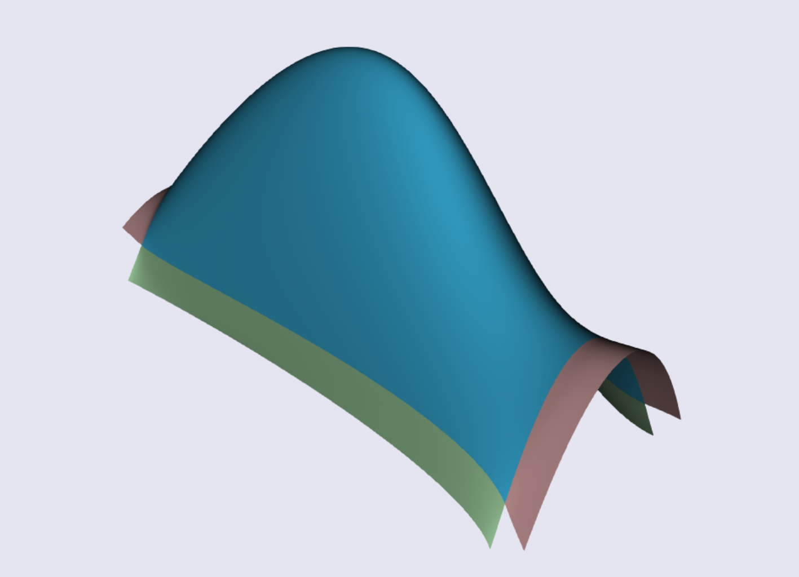
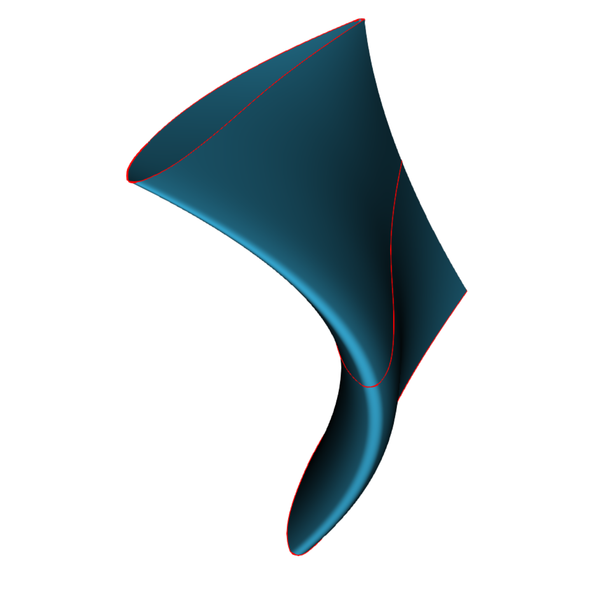

# GBS Release Notes
Unreleased

Features
* `gbs-io/brep_json.h` (new): exact files of a BREP model (`docs/sources/design/io_brep_json.md`, which also specifies the format and answers the requirements of CadSmith's review, need G11). `write_brep(m)` (a string; a stream; `write_brep_file`, whole or not at all; `write_brep_value`, a value of an application's own JSON document) and `read_brep<T>(text)` (a stream, `read_brep_file`, `read_brep_value`) give back the model that was written, not a copy of its shapes: every table at the same size, the dead entities included (dead again once read), so that every id held outside the model designates the same entity without renumbering; `write_brep_compact` writes it as `Model::compact()` makes it instead, with that `IdRemap`, the model untouched. The ids stored in the entities as they are, orientations, tolerances, flags, names, external ids, instances of parts, the next part key, the unit. The geometry is written once per object (by address) and referred to by index: shared by several entities or nested in another geometry, it is shared again once read (the same graph, not a tree). Every real bit for bit (shortest decimal form, read in full precision; -0 and subnormals included). The classes held are recognized by their exact type: B-spline and NURBS curves and surfaces (2D, 3D; their bounds when they differ from the end knots), line, ellipse, plane, cylinder, cone, sphere, torus (their frames and boxes as they are), curves trimmed, composite, reversed, reparametrized, extended, on a surface, offset, moved, surfaces of revolution, offset, moved and seamless; the result of every operation of gbs-brep is checked to round trip. Errors are `BuildResult`s, never exceptions: writing refuses, naming the entity and before anything is written, another class (the old `Line` and `Circle`, whose constructors normalize, a class of an application), a number not finite or a name not UTF-8 (the text is standard JSON) with `UnsupportedEntity`, an id beyond its table with `InvalidId`; reading refuses a newer version with `UnsupportedVersion` (new), and a text cut short, not a model or corrupt with `InvalidFile`, the message giving the JSON pointer of the value at fault: parsed without recursion, a strict schema (an unknown or repeated key is a fault), every index below its table, a geometry referring only to those before it and of the right kind, the knots of B-splines checked, the refusals of gbs's constructors reported at the geometry (tested on 3,000 randomly damaged texts, under AddressSanitizer and UndefinedBehaviorSanitizer). Writing is a pure function of the const model, deterministic (the same model, the same bytes). JSON (RapidJSON) rather than binary, on measurements: 0.6 to 0.9 times the size of the STEP file, read and written at 0.35 to 0.55 GB/s (a part of 18.8 MB of STEP read in 9.6 s: 10.7 MB of JSON read in 24 ms; 30,000 faces: 16.6 MB written in 36 ms, read in 44 ms). `gbs-brep/equal.h` (new): `brep::equal(a, b)` and `brep::first_difference(a, b)` ("edge 12: B-spline poles differ"): the same tables and ids, fields, attributes, geometry bit for bit (defining data and values at samples) and sharing. `gbs-brep/seamless.h` (new): `SeamlessSurface`, the view past its seam of a closed B-spline face that the contacts of a fillet keep in the model, moved out of `fillet.h` so that the writer knows it. `Model::nextPart()`, `Model::reservePartKeys(next)`; `BuildErrc::UnsupportedVersion`; `unwrap` of a `BuildResult<void>`. Python: `brep.write_brep(model, path, pretty=False)`, `brep.write_brep_text`, `brep.write_brep_compact_text` (text, remap), `brep.read_brep(path)`, `brep.read_brep_text`, `brep.equal`, `brep.first_difference`, a failure raising `BRepError` with its code; a `Model` pickles through the same text.
* `gbs-brep/face_blend.h`, `gbs-brep/blend.h`, `gbs-brep/fillet.h`, `gbs-brep/radius_law.h`: partial strips, laws and sections of fillets between faces (stage 8, PR 2, `docs/sources/design/brep8_pr02_partial_strips_laws.md`). `fillet_faces` takes faces that already meet along part of their length, a strip running on from their common edge e elsewhere: a face G of neither side that touches both, its edges with them ending on a vertex of e, is of the strip, not an end face (a face tapering to a point on e, the triangle closing a chamfer stopped on e, a chamfer between two common edges); on the copy the virtual edge continues e, both fused into one edge (the intersection recomputed over their union, the vertex between them taken out), one fillet in one piece, as that of the edge before the strip (to 1e-9 in volume, and against `BRepFilletAPI_MakeFillet`; PR 1 refused it: "meet along edges in places only"); a radius too small spills over the strip, refused (a face 0.085 wide from the corner of a U: refused at r = 0.2, the arc 0.083 from it, swallowed at 0.3). `fillet` of the edge alone still does not cross the strip, its refusal at the end naming `fillet_faces` ("faces between its faces there, fillet_faces swallows them"). `fillet_faces(m, s, faces1, faces2, RadiusLaw, options)`, `fillet_faces_chordal(m, s, faces1, faces2, c, options)`, and the sections of stage 7 (conic, G2) on the virtual edge. `BlendPoint::at_point(p, value)`: a point of a law given by position, put at its foot on the nearest edge blended (on the virtual edge for a fillet of faces, its points on edges of the solid put there too), for every law of fillets and chamfers, the geometry of one edge too (`fillet_geometry`, `chamfer_geometry`, a conic section, a law of one value included); refused (`InvalidBounds`) farther than ten times its value and the length of the edge, or at the same foot as another of a different value. A common edge from the strip to the strip (the rest of the foot of a boss chamfered over its seam) lies under the virtual edge from end to end; strips on both sides of a common edge are refused; of several strips tried, the refusal given is that of the one closed over. `fillet_faces_chordal` shares the geometry of `fillet_chordal` (`blend_detail::chordal_blend`). Python: `brep.fillet_faces(..., law, options)`, `brep.fillet_faces_chordal`, `brep.BlendPoint.at_point(point, value)`, the rule of the faces swallowed in the docstring of `fillet_faces`; gallery: `fillet_faces_tapered`.
* `gbs-brep/face_blend.h` (new): fillets between two faces that have no edge in common (stage 8, PR 1, `docs/sources/design/brep_palier8_face_blends.md`, `docs/sources/design/brep8_pr01_face_blends.md`). `fillet_faces(m, s, faces1, faces2, r, options)`: each side a face or faces joined tangentially (the side of a stadium slab); the faces between them (the strip, bounded by end faces that touch both sides) swallowed. On a copy of the solid the strip is taken out and both sides continued until they meet: the edges ending on the strip (spokes: between a side and an end face, two faces of a side, a seam) continued to the face across, the virtual edge between those points on the intersection of the sides continued, the wires of the faces kept closed over it; the fillet of that edge (`fillet`: free ends on the end faces, chains, sections), kept if the strip lies wholly on the side it takes off, or adds (a groove filled in: its edges with the end faces then on the result). Faces that all have edges in common with the other side (and no strip elsewhere): the fillet of those edges. Refused: a fillet that spills over the strip (a radius too small), sides that do not meet once continued (parallel faces, two ribs on a plate), faces that meet along edges in places only (a chamfer along part of an edge), a strip that runs round the rest of the solid (a chamfer ending on another chamfer: no end face touches both sides); `InvalidId`: a face on both sides, the faces of a side not joined tangentially (within `angular_tol`). Against the fillet of the edge before the chamfer: the same solid, volumes to 1e-9 (box, step, V groove), 1e-8 (the foot of a boss, a torus), 1e-7 (the foot of a stadium slab, a set of four faces); OCCT's `BRepFilletAPI_MakeFillet` on that edge: the same solid. Python: `brep.fillet_faces`. Two gallery cases.
* `gbs-brep/blend.h`: fillets that swallow a pocket (`docs/sources/design/brep_swallowed_faces.md`, `docs/sources/design/brep_swallowed_faces_pr01.md`). Where the two faces of filleted edges meet again past the ends of the edges round a few small faces (the sliver left on the top of a cylinder cut by a tilted plane, a shallow flat across an edge), and the fillet passes beside them without touching them, `fillet` (radius or law) and `fillet_chordal` fill the pocket on a copy (the surfaces of both faces continued, their intersection from one end to the other as an edge, the bridge), fillets the chain through the bridge, and keeps the result when every point of the pocket is on its side of the result and no face of the pocket meets it: the pocket and its edges, given or not, disappear, with the points of a law and the setbacks on them (convex and concave edges). A bridge on a circle or an ellipse may run across the origin of its parameter. A fillet that cuts through a pocket instead (it rolls over a sharp edge next to it) is refused as `overflow` where the mitres and free ends refuse it too. At a joint of a chain, the arc of the second fillet is projected from that of the first when both surfaces put it on other parameters (it was refused). Not handled: chamfers (next PR), a seam of either face running into the pocket, the two ends of one edge bounding a pocket.
* `gbs/movingframe.h` (new): `MovingFrame`, a moving frame along a curve (o on it, z the unit tangent): rotation-minimizing (`FrameLaw::RotationMinimizing`, the double reflection of Wang, Jüttler, Zheng and Liu, the stations doubled until the frame moves by less than `angle_tol`, one double reflection from the previous station in between; on a closed path the residual angle, `closure_angle()`, spread along it), Frenet (refused where the curvature vanishes, where its binormal reverses, also between the samples or at a break, and on a curve without second derivatives) or a fixed binormal (refused where the tangent is along it, also between the samples); breaks of a path only G1 are stations, the frame at the end of the piece before a break is the limit from the left; an `angle_tol` that cannot be reached is a `std::runtime_error`. `gbs-brep/pipe.h` (new): `make_pipe(model, profile, path, PipeOptions)` (stage 4, PR 2, `docs/sources/design/brep4_pr02_pipe.md`), the sweep of an edge, a wire or a face along an edge or a G1 wire, carried by the frame (`PipeOptions::frame`, `binormal`), the profile taken as it is: along a segment where the frame does not turn, the prism of the placed profile, along an arc of circle (recognized on its points, whatever the type of its curve) where it turns with the arc, its revolution (planes, cylinders, cones, spheres, tori, exact NURBS), each path edge swept by its own frame up to its end; otherwise B-spline faces, the profile placed at stations and skinned, the stations doubled until within `approx_tol` of the exact sweep (`SweepResult::approximated`, `deviation`); a face gives a solid closed by the profile and its copy at the end, no caps along a closed path. Refused (`NonGeneric`): a corner of the path (its angle times the size of the profile beyond the tolerance of the junction, `tol` or that of its vertex), a frame that moves the profile at a junction beyond it (Frenet across a change of the principal normal), a profile beyond the radius of curvature of the path (the surface folds), a sweep that intersects itself away from the folds (the path coming back within the size of the profile), a frame undefined on the path, a closed path along which the profile does not come back onto itself; a profile that is not an edge, a wire or a face is `InvalidId`, tolerances that are not positive `InvalidBounds`, an accuracy that cannot be reached `PCurveApproximation`; the model is left as it was. `sweep_detail::sweep` sews within a given tolerance at least (the gaps at the junctions of a path). `gbs-brep/edit.h`: `moved_curve(curve, placement)`. Python: `brep.make_pipe`, `brep.PipeOptions`, `brep.PipeFrame`. Gallery: a section of sweeps; the OpenCascade comparison gains `pipes` (`BRepOffsetAPI_MakePipeShell`)

* `gbs-brep/thick.h` (new): `offset_solid(model, solid, d, OffsetOptions)` and `make_thick(model, solid, removed, t, OffsetOptions)` (stage 4, PR 4, `docs/sources/design/brep4_pr04_offset_solid.md`). The offset of a solid with sharp joints, each face on its offset surface (exact for the primitives) along the outward normal (d > 0 grows it): an edge where the offsets of its faces meet along one curve (tangent faces at the same distance, a seam) is its pcurve on the offset, continued past its ends as needed; any other edge is the intersection of the offsets of its two faces (closed forms between primitives, marching otherwise), the branch through its new vertices (on a loop, the arc nearest the old edge; a closed edge, the loop run from its vertex, also where the box of a closed B-spline cuts it at its seam); the faces are continued past their sharp edges by what the joint needs (a primitive on a wider box, a B-spline by the polynomials of its end spans, but across its seam or past a pole); a vertex is the point common to the offsets around it (Gauss-Newton started off the poles, its steps where a curve cannot be evaluated halved: on its tangent edge when it has one, on all its faces otherwise, between two faces, a vertex between two arcs of a circle, in the plane across it), a pole of a face at a sharp vertex left out of its wire. Solids written by other systems are offset: circles in two arcs, vertices at the poles of a sphere, cylinders of NURBS (where OpenCascade's own offset fails). A thick solid is the solid minus its offset by -t with the removed faces offset by 0 (`cut`, the coincident faces opening it); t < 0 grows outward; no removed face gives a hollow solid with a void. Refused (`NonGeneric`): an offset that folds (the apex of a cone), a face that vanishes, an offset intersecting itself (faces sharing no vertex that meet), a vertex where the offsets do not meet at one point, a face whose offset would cover the pole of its sphere at a sharp vertex (a ball cut through its poles, offset outward), an edge partly tangent, a joint too sharp to be continued (`max_extension`); the model is left as it was. `gbs/bsctools.h`: `extrapolated(crv, dt)`, a B-spline curve continued by the polynomials of its end spans (the curve counterpart of `extrapolated_v`); the internal namespaces of `gbs/bsstools.h` renamed (`bss_detail`, `bsc_detail`), so that `gbs-brep/brep` does not make `detail::` ambiguous under `using namespace gbs; using namespace gbs::brep;`. Python: `brep.offset_solid`, `brep.make_thick`, `brep.OffsetOptions`. Gallery: a section of offset and thick solids; the OpenCascade comparison gains `offsets` (`BRepOffsetAPI_MakeOffsetShape`, `BRepOffsetAPI_MakeThickSolid`, sharp joints: same volumes and faces; on solids OpenCascade cannot offset, gbs's result read back valid, with its exact volume)
* `gbs-brep/fillet.h`: the G2 section of fillets (stage 7, PR 3, `docs/sources/design/brep7_pr03_g2_sections.md`). `BlendSection::g2()` (`SectionKind::G2`): the quartic Bezier tangent to the faces with their curvature across at its contacts, of the smoothest shape (the least integral of the square of the derivative of its curvature), its contacts spread for the sag of the arc of radius r (1.305 r at right angles, rule C of `docs/sources/design/brep_palier7_blend_sections.md`, § 4.4). Constant radius or law; an exact extrusion of degree (4, 1) along straight edges between planes, or between a plane and a cylinder along the edge; skinned elsewhere, with a crease where its contacts cross a knot of a B-spline face below C3 or the seam of a face closing without being periodic (the curvature of the face kinks there; a blade at its root); vertex blends at corners. Refused: with a constant chord, with a radius law that kinks. Python: `brep.SectionKind.G2`, `brep.BlendSection.g2()`. The summary of stage 7 in its design note, § 9.
* `gbs-brep/fillet.h`, `gbs-brep/blend.h`: sections of fillets (stage 7, PR 2, `docs/sources/design/brep7_pr02_conic_chordal.md`). `FilletOptions::section` (`BlendSection`: `circular()`, `conic(rho)`, `conic(law)`): the conic tangent to the faces at the contacts of the fillet of the radius, the middle pole of its arc of circle weighted rho / (1 - rho) (rho of the circle: the circle; 0.5 a parabola), rho constant or following a `BlendLaw`; exact extrusions (rational, degree (2, 1)) along a straight centre line, skinned elsewhere, the normal checked against the exact sections; where a law of rho kinks the surface creases (6.5 degrees for 0.3, 0.7, 0.3), a fillet of constant radius in pieces there sharing the section, refused along a radius law. `fillet_chordal(m, s, edges, c)`, `fillet_chordal_geometry`: the contacts c apart at every station, the radius following the angle of the faces (secant on the radius, the balls marched from the middle of the edge, as far as the fillet is continued: along chains too), the envelope of the balls of a radius law. A corner of conic fillets is a vertex blend (`EdgeBlend::circular`). Volumes against the areas of the conics (Green) and Pappus: 1e-9 exact, 1e-5 skinned. Python: `brep.BlendSection`, `brep.SectionKind`, `FilletOptions.section`, `brep.fillet_chordal`. Three gallery cases.
* `gbs-brep/blend.h`, `gbs-brep/fillet.h`, `gbs-brep/radius_law.h`: variable chamfers (stage 7, PR 1, `docs/sources/design/brep_palier7_blend_sections.md`, `docs/sources/design/brep7_pr01_variable_chamfers.md`). `BlendLaw` (`BlendPoint`: edge, at, value; `BlendVariation`), the law of stage 5 for any value of a blend, `RadiusLaw`, `RadiusPoint`, `RadiusVariation` its aliases (the field `radius` now `value`; still `radius` in Python too, with the keywords `radius`, `r1`, `r2`). `chamfer(m, s, edges, face, d1_law, d2_law)`, `chamfer(m, s, edges, law)` (both faces), `chamfer_angle(m, s, edges, face, d1, angle)` (the other contact where the line from the first, at the angle from the tangent plane of its face there, meets the other face, in the plane normal to the edge), `chamfer_geometry` with laws, `chamfer_angle_geometry`; the contacts at d(t) station by station, in pieces joined C0 where the slope of a law jumps, the chamfer in ruled pieces with a crease along the ruling there; the ruled surface between two B-spline contacts on planes built exactly on their poles, piece by piece too, and marked `exact` (a hyperbolic paraboloid for a linear law along a straight edge). Volumes exact to 1e-9 on box edges, 1e-6 round a cylinder, a stadium slab and for an angle on a half cylinder; OCCT's `AddDD` and `AddDA` (at 90 and 120 degrees): the same volumes to 1e-9, the same faces. Python: `brep.BlendLaw`, `brep.BlendPoint`, `brep.BlendVariation`, `brep.chamfer` with laws, `brep.chamfer_angle`, `brep.chamfer_angle_geometry`. Three gallery cases.
* `gbs-brep/fillet.h` (new): the geometry of a constant-radius fillet and of a chamfer along an edge of a solid, the model left unchanged (stage 4, PR 5, `docs/sources/design/brep4_pr05_fillet_geometry.md`): `fillet_geometry(model, solid, edge, r, FilletOptions)` and `chamfer_geometry(model, solid, edge, face, d1, d2, FilletOptions)` (d1 on `face`) return an `EdgeBlend` (the surface, exact or within `deviation`, the centre line or the edge continued, the two contacts as `BlendContact`: the face, its surface continued, the pcurve on it, the curve, the pcurve on the blend, every curve on the same parameter, `t1` and `t2` at the vertices of the edge, `t1 > t2` where the spine runs the other way, a closed edge included). The ball lies inside a convex edge and outside a concave one (read on the outward normals and the directions of the faces away from the edge); its centre line is the intersection of the surfaces of the faces, continued and offset by r toward it (closed forms between primitives, marching otherwise), the branch nearest the edge, continued by `extension` r past its vertices (a closed edge: its whole loop); the contacts are its feet on the faces. The surface is the envelope of the ball: a cylinder around a straight centre line, a torus around a circular one, whatever the faces (plane and sphere, parallel cylinders included); otherwise a rational B-spline, the exact arcs of circle between the contacts (one or two quadratic segments) at stations put back on the rolling ball by Gauss-Newton (the marched centre line only starts it: where the faces become nearly tangent its contacts were 3e-7 off the radius and the fillet was refused), their homogeneous poles and their derivatives along the centre line interpolated by cubic Hermite, the stations doubled until within `approx_tol` in position and `angular_tol` in normal (position alone left the normal 3e-4 off). A chamfer takes its distances from the edge in the plane across it (as CATIA, SolidWorks and OpenCascade), each contact marched from the middle of the edge with a first-order predictor, on the side of the face, and interpolated within tol / 10 (the accuracy of the contacts of a fillet on primitives); the edge is continued past its vertices whatever its curve (a curve on a surface, the edges of a boolean, by its pcurve on the surface of its face continued); the ruled surface between the contacts is a plane, a cylinder or a cone when they are lines in a plane or coaxial circles, a ruled B-spline otherwise (a primitive only when the contacts lie on it within tol). Refused (`NonGeneric`): a radius beyond a radius of curvature of a face, a contact off its face (out at the middle of the edge, or leaving it across an edge other than those at the vertices: past an acute corner, the faces at the ends cut it), faces tangent along the edge (a fillet vanishing where they become tangent at a vertex is given, its contacts meeting there, and ends there, not continued past it), an edge convex in places and concave in others, any other failure (a curve evaluated beyond its bounds); `InvalidId`: an edge not of the solid, not shared by two faces, a seam, the face of d1 not of the edge; `InvalidBounds`: a radius or a distance not positive, tolerances not positive, a negative extension. Python: `brep.fillet_geometry`, `brep.chamfer_geometry`, `brep.FilletOptions`, `brep.EdgeBlend`, `brep.BlendContact`. Gallery: a section of fillet and chamfer geometry; the OpenCascade comparison gains `fillet_geometry` (`BRepFilletAPI_MakeFillet`, `BRepFilletAPI_MakeChamfer`: within 1e-15 on primitives, 3e-6 along B-spline faces; 1.1e-4 where two cylinders cross, OpenCascade's fillet being 8e-5 off the rolling ball there)
* `gbs-brep/blend.h`: vertex blends (stage 6, PR 3, `docs/sources/design/brep6_pr03_vertex_blends.md`). At a vertex whose n edges are all filleted and whose sphere is not exact (radii that differ, more than three edges, a radius dropping toward the corner, convex and concave edges) or where setbacks are asked, one B-spline face tangent to the fillets and the faces round it: each fillet ends on its section where the farther contact of its neighbours crosses its own (or farther: `FilletOptions::setbacks`, `Setback(vertex, edge, distance)` along the edge, a suitcase corner), Hermite joining curves on the faces between contacts that end apart, the hole filled by `fill_n_sided`. Where two contacts would end nearly at one point, both end at their crossing (radii nearly equal: no tiny side, the blend tends to the sphere as the radii agree, 4e-5 off at 1e-4) or both fillets are set back by a quarter of their radius (contacts oblique between different radii: sections that cannot meet G1 on a C2 surface); the end of a fillet between two joining curves shorter than a tenth of the hole is set back until they are that long (two short sides round one end fold the fill: radii 0.5, 0.51 and 0.52 were refused after 30 s); a setback asked is kept, never brought to a crossing, and refused at once where it would leave a joining curve under 7e-3 of the hole, or two under 5e-2 round its fillet. G1 within 1e-5 along every side; the same faces as OCCT on a box corner of three radii, 0.014 more taken off. The corner of an L and a radius dropping toward a corner, refused until now, are vertex blends. Five gallery cases. Python: `brep.Setback`, `FilletOptions.setbacks` (a tuple, set by assigning a list).
* `gbs/nsided.h`: `NSidedOptions::sphere` (`GuideSphere`: centre, radius, weight), a sphere the surface leans toward inside, fading to none at the sides (the octant of a sphere within 4e-4 of it, 8 % without), each point pulled toward the foot on the sphere of the surface before, each coordinate on its own (a row along the radius alone coupled the three: 860 MB and 26 s up to 128 spans, now 340 MB and 7 s); the shape criterion takes the move still to come where the moves fall geometrically. Python: `gbs.GuideSphere`, `NSidedOptions.sphere` (set by assigning a new sphere, whose fields are read only).
* `gbs/nsided.h` (new): `fill_n_sided(ribbons, NSidedOptions)`, the surface filling an n-sided hole tangent to the surfaces round it (stage 6, PR 2, `docs/sources/design/brep6_pr02_nsided.md`). Each side a `Ribbon` (a curve and a cross direction tangent to the surface next to it); the result a bicubic B-spline on [-1, 1]^2 to be trimmed by the regular polygon of its domain (`NSidedSurface`: surface, polygon, deviation, angle, spans), of least bending energy (integrated over the polygon by a Dunavant rule on small triangles) under the sides: points on the curves and normals of the ribbons held (G1 within `approx_tol` and `angular_tol`), cross derivatives made compatible at the corners held in the middle of the sides, not at the corners; the spans doubled until the tolerances are met along the sides and the shape settles inside. Surfaces of the second degree are found again (within 3e-5); the octant of a sphere is within 4 to 8 % of the radius (the least bending energy is not the sphere). A Kato transfinite surface, planned as a guide, sagged by up to a third of the depth: not used. Python: `gbs.Ribbon`, `gbs.NSidedOptions`, `gbs.NSidedSurface`, `gbs.fill_n_sided`.
* `gbs-brep/blend.h`: blends meeting at a vertex (stage 6, PR 1, `docs/sources/design/brep_palier6_vertex_blends.md`, `docs/sources/design/brep6_pr01_mitres.md`). Two fillets or chamfers at a vertex of three edges, not tangent there, the third edge sharp: a mitre, the blends cut along the curve where they meet, from where their contacts cross on the face between them (both fillets touch that face there: a double point of the curve, given, the curve marched from its other end); the narrower ends on it, the wider goes on, cut by the face beyond the sharp edge, which is cut short (the blends continued further where the other contact of one does not reach the sharp edge, as at a free end; a convex and a concave edge refused). Three chamfers at a vertex of three edges: a mitre through their common point (OCCT cuts the corner off by a triangle through the crossings of the contacts: d^3 / 12 less, reported). A free end at a vertex of n > 3 edges: cut by the n - 2 faces round it in turn, the edges between them split where the blend meets them. The sphere of a corner of n fillets (the top of a pyramid: four arcs) where the n centre lines meet. The curve across a blend where it meets another surface shared by the free ends and the mitres (`cross_curve`); ends of several edges (`End::pieces`). Volumes against references worked out on their own (the overlap of two fillets integrated, inclusion-exclusion of chamfers, Steiner's formula for the rounded pyramid: 1e-9 to 1e-12, 1e-8); beside OCCT, the same solids. Five gallery cases.
* `gbs-brep/blend.h`, `gbs-brep/fillet.h`: fillets of a varying radius on the solid (stage 5, PR 2, `docs/sources/design/brep5_pr02_variable_topology.md`). `fillet(model, solid, edges, RadiusLaw, FilletOptions)`: the law runs along each chain of tangent edges given (by the arc length along the chain); the fillet in pieces where the centre line of the balls has a corner (a kink of a linear law, or the curvature of the edge jumping while the radius varies: a straight edge meeting a circle, the vertex of a closed edge that is not C2). There the balls next to the point cover the middle of the lune of its ball between its two characteristic circles, and the envelopes meet along a crease (a peak of the law: `EdgeBlend::creases`, marched across the pieces), or they do not, and the lune is part of the fillet (a hollow); the lunes are faces of spheres oriented against the faces of their pieces. At a vertex of a chain, past which the law of each edge goes on with its own slope, the joint of the two fillets decides (fillets with a law only: chamfers and fillets of constant radius that do not join there stay refused), both continued past it by 1.5 radius at least whatever `extension`. The supports, their reach and the folding of the offsets are checked for the largest radius of each edge, its own, and for the pieces continued past a peak with their slope. Corners where the radius grows toward the corner (the ends of the fillets small circles of the ball of the corner); a radius dropping toward a corner refused. Round a closed B-spline face that is not periodic (the root of a blade), the loop starts on the seam of the face. The stations of a law are first marched from end to end (512 steps, halved where Gauss-Newton fails or the contacts jump: the far side of a thin trailing edge in the plane normal to the edge). Python: `RadiusLaw`, `RadiusPoint`, `RadiusVariation`, `fillet` and `fillet_geometry` with a law, `BlendPiece`, `BlendLune`, `BlendCrease`; three gallery cases. Volumes checked against an independent integration of the union of the balls (within 2e-7); beside OCCT's `Add(R1, R2, E)` only reported (its linear law takes off 2 to 3 % more).
* `gbs-brep/radius_law.h` (new) and `gbs-brep/fillet.h`: fillets of a radius varying along their edge, their geometry (stage 5, PR 1, `docs/sources/design/brep_palier5_variable_fillets.md`, `docs/sources/design/brep5_pr01_variable_geometry.md`). `RadiusLaw` (control points `RadiusPoint`: an edge, a fraction of its length, a radius; `RadiusVariation::Linear` or `Smooth`) is a `BSCfunction` of the arc length: degree 1 through the points, or the monotone cubic Hermite of Fritsch and Carlson as a cubic B-spline with double knots (C1, zero slopes at the ends of an open law, never beyond the radii on either side of a span). `fillet_geometry(model, solid, edge, law, FilletOptions)`: at each station the ball of radius r(t) in the plane normal to the edge, touching both faces (Gauss-Newton); the surface the envelope of the balls, the arc of the characteristic circle between the contacts (its centre from the contacts, in the plane normal to the centre line), skinned as the fillets of constant radius. Where the slope of a linear law jumps, the fillet comes in pieces (`EdgeBlend::pieces`) and the ball sweeps a lune of its sphere between its two characteristic circles (`EdgeBlend::lunes`); a linear law goes on with its slope past its first and last points, a smooth one at constant radius; the supports reach, and the offsets are checked against folding, for the largest radius of the blend, its ends included; the direction of the centre line from the implicit derivative of the equations of a station; the pcurves of a lune on its sphere interpolated until within tol / 10 between their points (`sphere_pcurve`, shared with the corners). The same radius everywhere: the fillet of constant radius. The approximated fillets halve a span whose pcurve strays out of the support continued instead of throwing (a refusal of a station goes on up). Refused: a degenerate edge.
* `gbs-brep/blend.h`: corners of fillets (stage 4, PR 7, `docs/sources/design/brep4_pr07_fillet_corners.md`). At a vertex of three edges all filleted (`fillet`), the three centre lines meet at the centre of a sphere of the radius (Gauss-Newton on their three parameters); each fillet ends on its arc through that centre, a great circle of the sphere, the contacts of two fillets on their common face meeting at the foot of the centre on it, and the face of the sphere bounded by the three arcs fills the corner, convex (the corner of a box, the twelve edges of a box: the rounded box) or concave (the inner corner of a pocket) alike, faces at any angle; the poles of the sphere out of the patch of the corner and as far as can be from its arcs, its seam in the widest gap they leave round the pole (`corner_frame`), the pcurves of the arcs on the sphere interpolated finer until within tol / 10 between their points and their edges as loose as the gap measured there (at a sharp corner, every pole a few degrees from the arcs: 33 points left a pcurve 1.4e-4 off its edge at 1e-6, unseen by `check`). The new edges are made at least as loose as the faces they bound. Refused (`NonGeneric`): chamfers or a fourth edge at such a vertex, a corner of convex and concave edges, centre lines that do not meet within the blends continued, contacts that do not meet on a face. Python: `gbs.c3_connect`; the gallery gets the corner of a box, the rounded box and a blade fused to its hub filleted at its root (`blade_foil`, `blade`, `blade_on_hub` in the examples).
* `gbs-brep/fillet.h`: fillets along faces that close across a seam and cannot be evaluated past it (a closed B-spline: the skinned sections of a blade; an offset of one), seen past their seam (`SeamlessSurface`; a surface that repeats past its bounds, as an offset of a cylinder, keeps its exact offset); the loop of a fillet round such a face starts where its contact crosses the seam, its contact then within the bounds of the face (within tol in space). Round two such faces their seams must meet in the same section of the fillet (refused otherwise, not handled). The approximated fillets: the centre line and the contacts interpolated by cubic Hermite like the surface (the global cubic interpolation rang where a contact crosses a knot of its face below C3), a station put where a contact crosses such a knot, and only the spans out of tolerance halved, checked at their middle and where the slope of a cubic Hermite strays most against half the tolerances (they were all doubled until the first three quarter points of each span passed, up to 2048).
* `gbs-brep/blend.h` (new): `fillet(model, solid, edges, r, FilletOptions)`, `chamfer(model, solid, edges, d, FilletOptions)` and `chamfer(model, solid, edges, face, d1, d2, FilletOptions)` (stage 4, PR 6, `docs/sources/design/brep4_pr06_fillet_topology.md`): a new solid, the solid given unchanged (on failure the model left as it was). The solid is copied and, in the wire of each face of an edge, the run of co-edges through the blended edge replaced by the contacts of its blend (`fillet_geometry`, `chamfer_geometry`); convex and concave edges alike. Ends: free at a vertex of three edges (the contacts met on the third face by Gauss-Newton, the edges there split, the end curve where the blend meets that face marched across the blend and interpolated within tol / 10, the run through the vertex replaced by it: the face loses its corner, or gets it back along a concave edge; the blend continued 2, 4 or 8 times further when a contact does not reach the face), joined along a chain of tangent edges (both blends ending on the arc across them at the vertex; a contact passing onto the next face splits the edge between them), in a point where the fillet vanishes (a degenerate edge), and none on a closed edge (the face of the blend round its loop, across a seam). The contacts of a face chained and cut where they touch its boundary (a seam they cross); a loop clear of it replaces a wire of blended edges. The face of the blend oriented as the faces of its edge; the result checked. Refused (`NonGeneric`): blended edges meeting at a vertex but along a tangent chain (vertex blends: PR 7), a chain blended in part, a free end at a vertex of more than three edges, a blend wider than a face at an end, two blends whose contacts meet at a vertex of a face (a full round), a contact ending inside a face. When a contact does not reach the face at a free end, the blend is continued 2, 4 or 8 times further (from one radius or distance at least), any failure keeping the last geometry. Python: `brep.fillet`, `brep.chamfer`; a gallery section "Fillets and chamfers". The cones of chamfers are built from their smaller circle, their semi-angle positive as STEP has it (OCCT read the negative one as another cone); the STEP writer writes any cone of negative semi-angle as the same cone of positive angle, its axis turned over, and its pcurves with (u, v) turned into (-u, -v).
* `gbs/offsets.h`: offset surfaces (stage 4, PR 3, `docs/sources/design/brep4_pr03_offset_surfaces.md`). `OffsetSurface` (S + d n, moved from `gbs::brep`, which keeps an alias) has exact derivatives of any order, by Leibniz's rule on N = S_u x S_v, |N|² and N = |N| n (P^(a,b) from those of S up to (a + 1, b + 1), in one pass; `derivatives(u, v, nu, nv)` computes the rectangle asked, on the stack), where it had first derivatives by finite differences and no second ones: the marching now tells a tangency along a curve (a plane tangent to an offset NURBS cylinder: the tangent generatrix, where it gave two points and a singular result) and certifies contacts; at a degenerate point (a pole: S_u lu or S_v lv shorter than 1e-10 of the other, lu and lv the lengths of the bounds, the shorter one being the rounding of a null derivative) and within 1e-4 of the bounds of it, where the recurrences lose the digits of the distance squared, the derivatives are extrapolated (cubic) from four points 5e-4 of the bounds apart, toward the centre of the bounds or a corner: within about 1e-7 of their limits at the poles of a NURBS sphere; on a basis without second derivatives, the first ones by finite differences as before. `primitive_offset` (moved from `gbs-brep/offset.h`, its fold now measured on a box: a torus whose circle of centres would cross the axis, where a spindle torus was returned, a cone whose radius would cross its apex on the box, where the reference radius at v = 0 was tested, refusing a valid offset far from the apex and accepting one across it near it) and `offset_surface(s, d, tol, box)`, the offset exact when it can be (a primitive; an offset of an offset, that of its basis at the sum of the distances while its own offset does not fold, exact for a primitive basis; an `OffsetSurface` otherwise) and `nullopt` where it folds; `offset_margin(s, d, box)`, the smallest 1 - d k over the principal curvatures (sampled, with the knots of a B-spline or of the basis of an offset, then refined; the points near a degenerate one skipped; the curvatures from the second fundamental form on an orthonormal basis, exact at an umbilic). `gbs-brep/offset.h`: `offset_face` refuses an offset that folds on the face (`InvalidBounds`, as for a primitive; a B-spline face was offset beyond its radius of curvature) and offsets an offset face from its basis. Python: `OffsetSurface`, `offset_surface`, `offset_margin`. Gallery: a section of offset surfaces; the OpenCascade comparison gains `offset_surface_derivatives` (`Geom_OffsetSurface`, every derivative up to the third)
* `gbs-io/step`: offset surfaces in STEP (`docs/sources/design/step_pr11_offset_surfaces.md`). The reader takes an `OFFSET_SURFACE` of a B-spline, a surface of revolution, an extrusion, a trimmed surface or another offset (it threw `StepUnsupported` but on elementary surfaces): `OffsetDef`, read on a `gbs::OffsetSurface` of the surface of its basis, with its parameters; the offset of a trimmed surface is the trimmed offset, an offset of an offset that of its root at the sum of the distances. The points of a face are inverted by their foot on the root (the nearest point of a B-spline), then Newton on the offset (the nearest point of the offset itself where it meets itself, beyond 1e-3 |d| and 100 times the accuracy of the file), so that the box of a face on the offset of a non elementary surface, trimmed or not, is that of its points, and its fold (`gbs::offset_margin`) is measured on the face, without the margin of its box: a folded face fails, reported (the poles made for its seam are erased). The exact offsets of elementary surfaces follow the rules of `gbs::primitive_offset` (`gbs::torus_offset_cos_min`, `gbs::cone_offset_apexes`, new in `gbs/offsets.h`, shared by both): a torus whose offset would cross its axis keeps the v where it does not (it was read whole, folded), the bounds of a trimmed surface brought into that part, the apple of a degenerate torus is offset too; a cone keeps the v where neither radius crosses its apex (an offset inwards beyond the reference circle was refused, whatever the face; it is now the cone with its frame at its apex). The writer writes `OFFSET_SURFACE` for an `OffsetSurface` whose basis is a primitive, a B-spline or such an offset, C1 by its knots (OCCT refuses the offset of a NURBS circle, with double knots: still approximated) and not the inner part of a degenerate torus, its basis written once per part. Compared with OpenCascade on faces on `Geom_OffsetSurface` of a B-spline and on solids offset by `BRepOffsetAPI_MakeOffsetShape` (offsets of B-splines, of a surface of revolution, of an extrusion), both ways.
* `gbs/bsctools.h`: `unify_curves(curves)`, the degree and the knots of a container of B-spline curves unified through their poles (`unify_degree`, `unify_knots` on their `BSCurveInfo`, a rational curve in its homogeneous poles): the highest degree, the bounds of the first curve, a common knot vector; fewer than two curves are left as they are. `join` and the lofts of `gbs/bssbuild.h` use it; the deprecated `unify_curves_degree`, `unify_curves_knots` and `unified_curves` now relay it.
Fixes
* Defects of the geometry found while documenting it (`tests/tests_geometry_fixes.cpp`, `python/tests/test_geometry_fixes.py`): `binomial_law` (`gbs/math.ixx`) computed by products, not factorials in `int` that overflowed beyond 12! (`increaseDegree` to degree 13 and above gave a wrong curve), exact for an integral type short of an overflow of the result itself; `CurveOnSurface::value(u, 2)` used d2u for d2v; `moved_to_constraints` (`gbs/bscshaping.h`) moved the curve by the target, not onto it; `BSSurfaceGeneral::pole(i, j)` read the pole j + i nu (i is now the rank along u, as documented and as the poles are stored) and throws `std::out_of_range` for an i or a j out of its range (an i past the row read the next one); `BSCurve2d_f` named no type; `max_coordinate` and `min_coordinate` (`gbs/extrema.h`) return the global extremum `{u, coordinate}` (they minimised 1/x² and x² locally and returned that value), `Xi` unused and optional in Python too; `length` of an unbounded curve (`Line`) throws `std::domain_error` (it returned a number or inf); `interpolate` of points alone with computed derivatives (`interpolate_c1(points)`) keeps Bessel's end tangents (they were zero); `build_3pt_tg_vec` (`gbs/bscinterp.h`, Python too) takes these ends from the differences divided by the parameters, as inside (the chords alone, and the last end itself: wrong but for unit parameters, `interpolate_c1` of points 100 apart went out of them by thousands), the chord over the parameters through two points, and throws `std::invalid_argument` for fewer, `build_3pt_tg_dir` the one before the last at its last end (it took itself); `unify_knots` of curves compares knots within a tolerance relative to the magnitude of the parameters (a loft of sections of large parameters, an arc of radius 1000, inserted a knot twice), inserts a knot of a higher multiplicity at the value already there and leaves the curves the same knots to the bit (they kept their own, a few ulps apart), and `change_bounds` leaves knots already at the bounds untouched; `approx(crv, u1, u2, ...)` samples between u1 and u2 (it sampled the whole curve). `join(crv1, crv2, tol)` (`gbs/bsctools.h`, Python `join(..., tol=...)`): an optional tolerance, `std::invalid_argument` (`ValueError`) if the ends are farther apart, written to their precision; without it, the mean of the ends as before. Python: `rotate` and `scale` of a point, `project_points` and `move_to_constraints_delta` return the result (a list cannot be changed in place: they did nothing), `pole` of curves and surfaces is a copy and `set_pole(i, pole)` / `set_pole(i, j, pole)` replace a pole (the `pole` said to edit returned a copy too), the second bindings of `tangential_direction` and `normal_direction` of curves are removed (the first answered, the right ones; the second bound the tangent to the normal), `extended(srf, l, location, ...)` is the surface extended (it gave the band added alone). `extended` at `U_START` / `V_START` (`gbs/bsstools.h`) keeps the parameters of the surface, the band before them (the whole surface was shifted to start at u1).
* Defects found while documenting the BREP kernel: the error of a failed fillet, chamfer, boolean, thickening or sweep names live entities of the model before the operation, those the failure concerns (not their copies erased by the rollback: `ShapeCopier::original`, `detail::rolled_back`): a fillet or a boolean brings the copies it names back to the entities they were copied from (`detail::to_originals`, the operands of a boolean each copied by its own copier), a thickening the faces of its offset back to the faces of the solid they offset, and the entities the attempt created are dropped; `gbs-io/iges_brep.h`: a wire back at its first vertex before its end (seam, circle, seam reversed, circle of a natural face of a surface of revolution, a sphere, a cylinder) starts in the middle of a co-edge, for libIGES refused the segments after a closed composite curve (the last circle was lost), a segment still refused counted in `IgesExportReport::lost_segments`; `add_brep` on a dead shape throws InvalidId (it wrote nothing and reported 0 faces); the STEP writer fails on a co-edge of a face without pcurve (MissingPCurve, as `step_writer.md` § 7 says; it skipped it), unless written without pcurves; `read_step` with a `target_unit_mm` other than the unit of a non-empty model gives InvalidOptions (InvalidFile); a fillet refused for its `angular_tol` says so (it named `approx_tol`); a fillet of constant chord between two planes is the exact fillet of radius c / (2 sin(phi / 2)), a cylinder (a rational B-spline on it); a mesh stopped at `max_points` is reported `incomplete` only (also `folded`), and the default deflection is 1e-3 of the diagonal of the exact box of the shape (`exact_bounding_box` of `gbs-brep/classify.h`, Python `brep.exact_bounding_box`: the extrema of the coordinates on the edges and inside the faces; the sampled `bounding_box` was 2.5 % smaller on a sphere). Python: the lists of the entities (`Shell.faces`, `Wire.coedges`, `Face.wires`, `Solid.voids`, `Compound.shapes`) are tuples of copies, set by assigning a whole sequence (assigning an item changed a copy). **API change**: `shell.faces[0] = f` raises `TypeError`, and a comparison with a list is False without error (`solid.voids == []`): compare `list(solid.voids)`, or with a tuple. `BRepError.shapes` is a tuple too after a failure (it was a list, the default `()`); the `repr` of a `CheckEntry` gives the type of its entity; `IgesExportReport` has a `repr`; `IgesWriter.model()` gives the unit (`gbs.IgesUnit`) and resolution of the file.
* `python/vistaplot.py`, `docs/sources/examples/gbs_examples.py`: meshes of the BREP are shaded by the exact normals of the surfaces. `mesh_to_polydata` and `face_polydata` stored them as a plain point array and drew with `smooth_shading=True`, with which PyVista computes its own normals: since no two triangles share a point, each corner got the normal of its triangle and the picture was faceted. The normals are now the active normals, drawn with `smooth_shading=False` and Phong interpolation (`plot_mesh`, `add_shape`, `gbs_examples.SHADE`; the views of meshes of the gallery and of the notebook on meshing too, which drew with the flat shading of PyVista's default theme, where the active normals are unused). `plot_curves`, `plot_surfaces` and `plot_mesh` no longer default to the `pythreejs` Jupyter backend, which PyVista no longer has (a notebook raised `ValueError`), but to PyVista's own
* `gbs/nsided.h`: `fill_n_sided` the same surface to scale. Its least squares weighted positions, normals and energy by different powers of the size of the hole: a hole ten times smaller, its tolerance in proportion, was refused (the shape still moving by 3.9 % at 64 spans). Every row is now relative to the size (stage 6, PR 3).
* `gbs-io/step/geometry_writer.h`: the pcurves of a face on an offset of a cone of negative semi-angle, or on an offset of such an offset, were written as they were, on an `OFFSET_SURFACE` of the cone written with a positive angle, thus of parameters (-u, -v): they lay elsewhere on the surface (3.7 to 4.1 away on a cone of radius 1.5). They are now written turned, as on the cone itself (`GeometryWriter::curve2d`). OCCT and gbs compute the pcurves of the faces they read from the 3D curves, so it did not show there; a reader taking the pcurves got another face
* `gbs/bscinterp.h`, `gbs/bssinterp.h`, `gbs/knotsfunctions.ixx`: an interpolation of degree p through n <= p points throws `std::domain_error` (`ValueError` in Python) instead of reading and writing out of bounds (a segmentation fault from `interpolate_cn(Q, u, p)`, #228). `check_degree(n, p)`, new, is called by every knot builder (`build_simple_mult_flat_knots(u, p)`, which also refuses a degree 0, and `build_simple_mult_flat_knots(u1, u2, n, p)`, exposed to Python, whose loop bound n - p wrapped around too; `build_mult_flat_knots` refuses fewer than two knot values), by `interpolate(Q, u, p)` and `interpolate(Q, p, mode)` of curves and functions, and by both interpolations of surfaces (on a grid, `interpolate(Q, n_poles_v, p, q, mode)`, and under constraints, whose n_polesv - q - 1 wrapped around), before any allocation; a degree 0 is refused too. The parameters of `interpolate(Q, u, p)` and of the Hermite interpolation `interpolate(Q, u, add_computed)` (Python `interpolate_c1`, `interpolate_c2`: a segmentation fault for a u of another size) must be as many as the points (two at least), finite and strictly increasing (`check_parameters`, `std::invalid_argument` naming the first at fault); computed from the points, the coincident or non-finite points are named. A surface refuses `n_poles_v = 0` and multiplicities 0 (a division by zero)
* `gbs-brep/closure.h`: `face_volume_integral`, thus `signed_volume` (the orientation of the solids in `make_solid`, `check` and the booleans), was wrong on faces with holes and trimmed faces: the midpoint rule on a grid of the (u,v) box counted the cells whose centre was in the face, an error of the order of a cell along every boundary that fell between the grid lines (a box 2 x 1.5 x 1 hollowed out to 0.1 and open at its top, whose top is a ring: 0.89775 instead of 0.894 at n = 160, 0.881 at n = 64). The integral over the region is now that over its wires (Green's theorem: F dv, F the integral along u), each wire taken with the sense expected of it (the outer one counter-clockwise in (u,v), the holes clockwise) whatever its own, by 10-point Gauss-Legendre rules (Boost's): along the smooth spans of each pcurve, cut where it crosses a knot of the surface; along u on panels cut at the knots in u, the integrals up to each panel tabulated at 16 Chebyshev points of intervals of v cut at the knots in v and interpolated, so that the cost follows the nodes along the wires and the knot cells met, not their product (15 ms for a surface of 100 spans with pcurves of 100 spans, where integrating every panel at each node took 284 ms). Exact to the rounding on planar faces and on polynomial B-spline faces of degree up to 3 with straight pcurves, whatever their holes, at any n; on curved faces the error falls as a high power of 1 / n (below 1e-13 on the solids of the STEP test files in closed form, 4.5e-9 on a cylinder limited by the pcurves of its disks). A parameter beyond the bounds of the surface by at most 1e-5 of their range (a pcurve within its tolerance off a boundary) is taken on them, where a B-spline would throw. `gbs/offsets.h`: `surface_flat_knots` (the knots of a B-spline surface or of the basis of an offset), public
* `gbs/curveoffset.h`: the derivatives of `CurveOffset3D` were wrong (the first one left out the derivative of the normal: off by about 1 on a B-spline); both offset curves now have exact derivatives of any order (`CurveOffset2D` threw beyond the second), by the recurrence of the offset surfaces (one, on a rectangle of orders), written in the header in the notation of gbs (the comments taken from OpenCascade are removed from `gbs/offsets.h`). Where the tangent vanishes (or lies along the direction in space), the point at an end of the curve takes the normal of its limit from inside (equal end poles), elsewhere and for the derivatives `std::domain_error` (it was NaN)
* `gbs/intersect/marching.h`: contact points between B-spline surfaces (stage 4, PR 1 bis, `docs/sources/design/brep4_pr01bis_point_contacts.md`): where two surfaces without a closed form touch at a point without crossing (a NURBS sphere on a plane, in a bowl), the marching stopped at once, the normals parallel, and reported the intersection singular, so the booleans refused it (`NonGeneric`) where the same model in primitives passed. The contact is now certified by the difference of the second fundamental forms (definite: `TangentMarcher::isolated_contact`) and put on the tangency by Newton; at a pole of a surface, the forms are taken next to it, each on the normal of its own surface, and the contact is the pole itself, with its foot on the other surface (`at_pole`). A branch point or a degenerate contact stays singular. As between primitives, surfaces placed within the tolerance of a contact give that contact point: above it without meeting (no start: found from the nearly parallel pairs), or sunk into each other (the small loop around the contact is that contact; a start that is not certified, within the reach of a certified contact, no longer makes the intersection singular); beyond the tolerance, a loop. The gallery case `nurbs_sphere_touching` is no longer a known limit; the OpenCascade comparison gains `sphere_touching_nurbs` and `plane_touching_nurbs_sphere`
* `gbs-render/vtkcurvesrender.h`: `scale_parts(s, assembly)` gives every part actor the scale s (it gave them 0.05 whatever s). `gbs-render/vtkgridrender.h`: the array of `add_value` has one value per point of the grid, set to the default value (`Allocate` left it empty).
* Build: deprecations are no longer silenced for GCC and Clang (`-Wno-deprecated-declarations` hid them but on macOS). `gbs-occt` uses the NCollection types of OCCT (`NCollection_Array1<gp_Pnt>`, `NCollection_List<TopoDS_Shape>`, `int`, `bool`...) instead of the typedefs that OCCT 8 deprecates, and `HArray1<T>` (`gbs-occt/harray1.h`, new) for the handled arrays, `NCollection_HArray1<T>` with OCCT 8 and the class of OCCT 7 otherwise. Boost is found by its own `BoostConfig.cmake` (policy CMP0167), in the build and in the installed `GBSConfig.cmake`. The `-utf-8` that an MSVC-built VTK exports on `VTK::fmt` for every compiler is kept for MSVC only (`cmake/GbsVtkFmt.cmake`, installed and included by `GBSConfig.cmake` for the projects using gbs-render): clang read it as `-u tf-8` and warned.

v0.7.1 — 9 nov 2026

Features
* `gbs/bsctools.h`: `blossom(poles, knots, degree, span, t)`, the polar form (blossom) of the polynomial that a B-spline follows on one of its spans, at degree values t: de Boor's algorithm with a value per level (Ramshaw); symmetric, affine in each value, the curve where they are equal, and pole i is the blossom at the knots i + 1 .. i + degree, so the poles of a piece on other knots (moved, inserted, a span continued past an end) are its blossoms at them; the values may lie outside the span. The knots and the values are spans (`std::span(k).subspan(i + 1, degree)`, a `std::array`, a vector) or a list (`{u, u, u}`); no allocation up to degree 15. `blossom(curve, span, t)` for a curve, homogeneous (the weight last) for a rational one. A knot vector not of poles + degree + 1 values, a span outside [degree, poles - 1] or empty, knots read decreasing or not a number, or not degree values throw `std::invalid_argument`. `extrapolated_v` computes its poles with it. Python: `blossom` (both forms; poles of 1 to 4 coordinates, the homogeneous poles of a rational curve included)
* `gbs-io/obj.h` (new): Wavefront OBJ files of a polygon mesh (`PolygonMesh`: vertices, faces of any number of sides, the polylines of `l` and the points of `p`, in float or double), as modellers (Blender, Maya, Rhino) export them; the faces and lines are stored flat (`Polygons`: one array of 32-bit indices and the start of each, spans by face, one allocation for all). `read_obj(text, source)` and `read_obj_file(path)` take the references `i`, `i/t`, `i//n` and `i/t/n` (the vertex only), negative ones relative to the vertices read so far, forward ones checked at the end, comments, `\` continuations, lines ended by `\n`, `\r\n` or a lone `\r`, a UTF-8 byte order mark; up to four numbers after z (a weight, a colour) are skipped, any other word is a fault; every other statement (`vt`, `vn`, `g`, `o`, `s`, `usemtl`, free-form geometry...) is skipped and counted by keyword (`ObjRead::skipped`); a face of fewer than 3 vertices, a line of fewer than 2, a reference of 0, out of range, beyond 2^32 - 1 or malformed, a coordinate missing or not finite in the type read throw `ObjError` with the line. `write_obj(mesh, comment)` and `write_obj_file` write the coordinates in their shortest exact form in their type (a float as a float), whole or not at all (`write_text_atomic`), and refuse what the reader would refuse. `parse_real`, the locale-independent reading of a decimal real of the STEP reader, moves to `gbs-io/real_format.h`, reads a float or a double, and refuses a hexadecimal real on every platform (strtod read it with the libc++ of conda-forge, from_chars did not); `append_real` of a float. `gbs-io/files.h`: `read_text_or_throw` and `TextError` (the base of `JsonError` and `ObjError`). Python: `brep.PolygonMesh`, `brep.read_obj`, `brep.read_obj_text`, `brep.write_obj` (a polygon mesh), `brep.write_obj_text`, `brep.ObjError` (a `ValueError` with `line` and `reason`), read and written without the GIL. Design: `docs/sources/design/io_obj_polygon_mesh.md`
* `gbs/bssjoin.h` (new): `join_surfaces(a, b, tol)` joins two non-rational B-spline surfaces, clamped at all their bounds, along a side they share within tol (any side of each, either way along, the outward directions agreeing; a side collapsed to a point, a pole or an apex, is none), keeping the smoothest of the joins: the parameters of a are kept (its bounds bit for bit), b is put beyond the side by an affine map given with the result (a swap, reversals, a scale so that the speeds across meet, a shift); along the side the degrees and knots of both are made the same (exact), the common row of poles is their mean, and the knot of the junction is removed as many times as every row allows (`knots_removed`: 0 for C0, p for pieces of one polynomial), with a bound of the change (`deviation`), measured, within tol. `join_surfaces(a, b, side_a, side_b, tol)` joins along the sides given (`SurfaceSide`); `side_a` and `side_b` say which were joined. `join_curves(a, b, tol)` does the same for two clamped curves end to end, each at its own speed: `join` of `bsctools.h`, then the removal. `join` shifts the knots of the second curve as k1_end + (k - k2_start), the end where the STEP reader puts the bound of a curve across its closure. `gbs-brep/unify.h`: two adjacent faces on two B-spline surfaces that join at least C1 along the side of an edge they share are put on the joined surface and merged, or left as they were when they would not merge (`UnifyReport::surfaces_joined`, also in `faces_merged`; one history entry per merge); a kink keeps them apart; `to_joined` puts two faces on the join alone. Edges that follow each other without a corner, on B-spline curves or curves on surfaces (the sides of natural faces), are joined (`join_smooth_edges`): the pieces of one B-spline surface become one face with its four sides. Python: `join_surfaces` (both forms), `SurfaceSide`, `SurfaceJoin3d`, `join_curves`, `CurveJoin2d`, `CurveJoin3d`, `UnifyReport.surfaces_joined`. Design: `docs/sources/design/brep4_pr01ter_join_bsplines.md`
* `gbs-io/knot_cleanup.h` (new): `clean_knots(curve or surface, tol, stats)` removes the knot spans of a B-spline whose image is shorter than tol (a knot one ulp off another, #213), the curve or surface staying within tol of the original at the same parameters: a knot moved onto its neighbour (never an end of the domain; the curve moves on the p + 1 spans on each side), the null poles dropped at an end, the multiplicity lowered back inside by knot removal, the result checked against the original on the window where it moved, refined to the union of their knots (a bound, rationals with positive weights included), a removal beyond tol undone; a knot vector that is not clamped is left as it is; `clean_knots(pcurve, surface, tol, stats)` measures the spans of a pcurve on its surface (its parameters scaled by the speeds of the surface along it, an estimate). STEP and IGES exports: the 3D curves of the edges, the surfaces of the faces and the pcurves are cleaned before writing, for readers that merge close knots (SolidWorks dropped such a face): **on by default**, `brep_default_tolerance` (the least uncertainty written), half the uncertainty given with one (an edge and its face, each moved by less, stay within it of each other), a span the file cannot tell from a point; `StepWriteOptions::knot_tol` and `IgesExportOptions::knot_tol` set it (at most half the STEP uncertainty given), 0 writes the B-splines as they are; the uncertainty (STEP) or resolution (IGES) computed covers the tolerance of the shape plus twice the deviation; `knot_cleanup` in the reports. Python: `knot_tol` argument of `brep.write_step`, `brep.write_step_text` and `IgesWriter.add_brep`, `KnotCleanupStats`. The Python tests display nothing unless `GBS_TEST_PLOT_ON` is set (`python/tests/conftest.py`), as `TEST_PLOT_ON` for the C++ tests. Design: `docs/sources/design/export_knot_cleanup.md`
* `gbs/bssanalysis.h`: `normal_direction(surface, u, v)`, the unit normal of a surface of 3D (S_u x S_v normed). The derivatives are compared as S_u Δu and S_v Δv (Δu, Δv the lengths of the bounds), so that the rule depends neither on the units nor on a scaling of the parameters: where |S_u Δu x S_v Δv| <= 1e-6 max(|S_u| Δu, |S_v| Δv)^2 (the rule of the meshes of `gbs-brep` on these derivatives), at a pole of a sphere or of a surface of revolution, along a collapsed row of poles, at the apex of a cone, it is the limit of the normal from inside the domain (three points on the way to the centre of the bounds, or to a corner where that way stays on the degenerate line, extrapolated: 5e-11 at the poles of a sphere, primitive or NURBS); on a surface more than 1e6 times longer than wide, the angle of S_u and S_v alone decides; `std::domain_error` (`ValueError` in Python) where the surface has no normal near the point either. `discretize_with_normals(surface, nu, nv)` gives the points of `discretize` and the normals there, in one loop. Python: `normal_direction(srf, u, v)`, `discretize_surface_with_normals(srf, nu, nv)`. `gbs-brep/offset.h`: `OffsetSurface` takes its normal from it: at the poles of a B-spline with a collapsed row of poles, the offset point (it was up to 0.23 off on a sphere of radius 2 offset by 0.5, the cross product being of the order of the rounding, or NaN), elsewhere the same within an ulp. `gbs/surfaceoffset.h` is removed (and no longer included by `gbs/surfaces`): its `SurfaceOffset` did not compile once instantiated (it called this function, which did not exist, `value(u)`, and had two bounds), had no derivatives and duplicated `OffsetSurface`. Design: `docs/sources/design/base_utilities.md`
* `gbs-io/json.h` (new, without geometry; included by `fromjson.h` and `tojson.h`): `parse_json(text, document, source)` and `parse_file` read numbers in full precision (`kParseFullPrecisionFlag`): what `write_js_doc` writes is read back bit for bit (the default parser of RapidJSON rounded some doubles to a neighbour); a syntax error throws `JsonError` (offset, line, column, `reason()`), and so does a NUL byte (RapidJSON ends the text there: what follows was not read); the document is then null. `gbs-io/files.h` (new): `read_text` (moved from `gbs::step::detail`), `utf8_string(path)` (a path for a message: `path::string()` throws on Windows for a name the code page cannot hold) and `write_text_atomic(path, text)`, which writes into a temporary file of a name of its own in the same directory and renames it over the file: a reader never sees it half written, two writers at once never mix their texts; as an in-place write, a symbolic link is written through, the file keeps its permissions and a file that cannot be written is refused; a hard link is broken (the other names keep the old text); on failure the file is untouched and `std::filesystem::filesystem_error` is thrown (on Windows, also while another process holds the file open without `FILE_SHARE_DELETE`)
* `gbs-brep/unify.h`, `gbs-brep/boolean.h`: faces of one domain unified at the end of the booleans (stage 4, PR 1, `docs/sources/design/brep4_pr01_unify.md`), as CATIA and SolidWorks do: adjacent faces of the result on the same surface, or on equal primitives (coplanar planes, coaxial cylinders: an affine map of the parameters, checked), facing the same way, become one face (`merge_faces`); a face across the seam of a periodic surface gets a window centred on it (`ElementarySurface::with_box`) and no seam; a plane in B-spline form next to a coplanar face is put on the `Plane` primitive (`to_plane`, exact pcurves); a face of a sphere around a pole, within a hemisphere, is put on the sphere turned so that it has neither seam nor degenerate edge (`reframe_pole`); edge pieces and seam pieces left are joined (`join_edges`, `join_seams`). `BooleanOptions::unify` (on by default), Python `unify` argument of `boolean`, `fuse`, `cut`, `common`, and `unify_faces` (the faces and an `UnifyReport`); the angle of a primitive is periodic whatever its box (`ElementarySurface::periods`). The OpenCascade comparison now expects the faces of `BRepAlgoAPI` unified by `ShapeUpgrade_UnifySameDomain`: as many on 27 pairs × 3 operations, fewer where OCCT keeps two pieces of a face (under a line of contact, the pinched side of Viviani's cylinder), never more; in the gallery, no face is parted from its neighbour by a seam any more
* `gbs/loft/loftCurves.h`: `loft_pieces(pieces, v, q, tol)`, skinned surfaces (The NURBS Book 10.3) through contours cut in pieces, `pieces[k][i]` the piece k of the contour i, each piece lofted on its own through its curves at the same parameters v, rational or not: each column of poles is interpolated on its own with the same v-knots, so that consecutive pieces sharing their end poles (and their weights) give surfaces sharing those boundaries exactly, the corners of the contours staying edges; fewer than two parameters, parameters not finite or not increasing, a piece without one curve per parameter, or consecutive pieces whose end poles are farther apart than tol (`brep_default_tolerance` by default) throw `std::invalid_argument`. `gbs/bsstools.h`: `extrapolated_v(surface, dv)`, a surface gone on past its ends across v, each end span continued as the same polynomial: its end knots moved and the q poles next to them made the blossom of that polynomial at the moved knots (`blossom`), no knot inserted, the surface unchanged within its bounds, a rational one continued in its homogeneous poles, each column on its own so that shared boundaries stay shared; a dv not finite, v-knots not clamped or an end continued without a span across v (an end knot of multiplicity beyond degree + 1) throw `std::invalid_argument`; `extrapolated_v_by_lengths(surfaces, lengths)`, surfaces sharing their v-knots continued by the same parameter, every point of each end at least the length given away (from the slowest point, raised while a continuation slows down; refused when it does not get that far or turns back on the way, for an end with a point without speed across v, lengths not finite or v-knots that differ); `slowest_across_v(surface, v, n)`, the smallest |dS/dv| along an iso-v, sampled across u then refined. `gbs-brep/sew.h`: `sewn_shell(model, surfaces, opts)`, the surfaces as natural faces sewn into one shell (`SewnShell`: the shell, its faces, the report of `sew`), each face with its own tolerance (the default one, or the sewing one when smaller, so that a sewing tolerance wider than a thin face neither collapses it nor spreads to every edge); when the faces make no shell (`Disconnected`) or no orientable one (`ShellNotOrientable`), everything made is erased; edges whose ends meet but whose curves part stay apart (`SewReport::rejected`). `gbs-brep/mesh.h`: `Mesh::edges`, the non-degenerate edges of the shape as the points of the mesh their faces share along them, from v1 to v2, to draw them. Python: `loft_pieces`, `extrapolated_v`, `extrapolated_v_by_lengths`, `slowest_across_v`, `brep.sewn_shell` (`SewnShell`), `Mesh.edges`
* `gbs/bssbuild.h`: `loft(curves, spine, v, q)` (a list of pointers or of `BSCurve`), a spine-guided loft at imposed parameters: curve i is the iso-v at v[i] (in the parameters of the spine), its foot on the spine is spine(v[i]), and the v-derivative there lies along the tangent of the spine, scaled by the spacing of each column of poles; each column is interpolated on its own with the same v-knots, so that the pieces of a contour lofted one by one at the same v share their boundaries exactly. v not one per curve, not finite, not strictly increasing or outside the spine throws `std::invalid_argument`, before any work. `get_tg_from_spine_at` gives the tangents for given feet; `get_tg_from_spine` (the closest feet) calls it

Fixes
* `CMakeLists.txt`: the installed package holds what its own headers include, so that a consumer can include `gbs-brep/mesh.h`, `gbs-io/step/reader.h` and `writer.h`: `gbs-brep/builders.h`, dropped by the rule excluding the build directories (now `build`, `build-*` and `build_*` only); the extension-less aggregator `gbs-brep/brep`, installed as `curves` and `surfaces` are; `include/gbs/inc` on the install interface of the `gbs` target, for `<topology/robustPredicates.h>` of `gbs-mesh/cdt.h`
* `gbs/knotsfunctions.ixx`: `change_bounds` (thus `BSCurve::changeBounds`, `BSSurface::changeUBounds` and `changeVBounds`) puts the knots at the ends on the bounds asked for exactly, the others within them: k1 + (k2 - k1) * 1 could miss k2 by an ulp while the bounds were set to k2, and with parameters of a few hundreds the curve or surface then refused to be evaluated at its own bound (beyond `knot_eps`); whether it did depended on the compiler contracting the expression into an FMA (arm64 did, x86-64 not)
* `gbs-io/step/geometry_writer.h`: the knots of a B-spline are grouped by exact equality: two knots closer than knot_eps (0.9 and 0.9000000000000001) were written as one knot of their summed multiplicity, above the degree + 1, an entity that the reader of gbs and other CAD systems reject (#213)
* `gbs/knotsfunctions.ixx`: a cut within `knot_eps` of a knot (`trim_begin`, `trim_end`, thus `trim`, `split_u`, `split_v` and the trimming of the exporters) is made at the knot (`snap_to_knot`): cut at 0.9 next to a knot 0.9000000000000001, a piece started with a span of an ulp (#213); the bounds asked for are kept. `trim_begin` at a knot of multiplicity degree + 1 (a corner) gave degree + 2 knots at the start and one pole too many
* `gbs/math.ixx`: `make_range(v1, v2, n)` computes each value as v1 + (v2 - v1) i / (n - 1), rounded once, as the 2D and 3D ranges do (it added up its step: 0.30000000000000004 for 0.3 with n = 11, and the 2D range did not give the same values). **Results change**: the inner values move by up to 1 ulp for n <= 11, 18 ulp for n = 100, 241 ulp (2.7e-14 over [0, 1]) for n = 1000, and so do the samples of everything built on it (`discretize` of curves and surfaces, `abs_curv`, `offsets.h`, `bssbuild.h`, `loftBase.h`, the meshes of `gbs-mesh`); a symmetric range goes through 0 exactly. The tests of gbs pass unchanged
* `gbs-io/json.h`: `parse_file` throws `JsonError` on a syntax error (the document was left empty or partial, silently), `std::filesystem::filesystem_error` with the reason of the system when the file cannot be read (it was `std::runtime_error` "File not found", whatever the reason; `filesystem_error` derives from it), and reads the file in binary; `write_js_doc` writes the file whole (`write_text_atomic`) and throws `std::filesystem::filesystem_error` when it cannot (it failed silently); both take a `std::filesystem::path`
* `gbs/bssanalysis.h`: `discretize(surface, nu, nv)` rethrows the first exception of a surface that throws at a node, in the order of the grid (`build_batch`); beyond 1000 nodes it terminated the process from its parallel loop
* `gbs/bssbuild.h`, `gbs/loft/loftBase.h`: the spine-guided loft `loft(curves, spine, q)` goes through the code of the loft at imposed parameters. **Results change**: its v-knots are averaged over the data sites, each parameter counted twice (The NURBS Book 9.8), instead of spread evenly whatever the parameters, which made the system singular for uneven sections (v = {0, 0.1, 1}, {0, 0.9, 1}, clustered chord lengths: infinite poles without an error; degree 1 keeps even knots); two consecutive sections at the same point of the spine (the two ends of a closed spine) throw `std::invalid_argument`; the core of the loft (`build_loft_surface_poles_core`, shared with the plain loft) throws `std::invalid_argument` on a singular system (its `rcond`, poles not finite) instead of returning infinite poles
* `gbs/knotsfunctions.ixx`: `build_simple_mult_flat_knots(u1, u2, n, p)` puts the interior knot j at j / (n - p); it was j / (n - p + 1), the last span twice as long. **Results change** for the curve approximation and `loft_approx`, which use it
* `gbs/bscanalysis.h`: `uniform_distrib_params` delegates to `arc_length_distrib_params` with the identity law; both reject u1 ≥ u2, fewer than 2 parameters, NaN or out of range arc lengths and a law that is not non decreasing within [0, 1] with `std::invalid_argument` (`ValueError` in Python) instead of failing later with a misleading "refine n_law" error or undefined behaviour (n = 1); an empty list of arc lengths returns an empty list without building the arc length function

v0.7.0 — 30 oct 2026

Features
* `gbs/bscanalysis.h`: `area_properties` gives the area enclosed by a closed chain of planar curves (a section contour, its pieces in order) and the centroid of that surface, by Green's theorem about the chain's first point. Each piece runs either way, from where the previous one ends (the sides of a section may both run from its leading edge); the order of the pieces gives the direction of the chain. A gap between pieces is closed by a straight segment, up to `max_gap` (by default any), a piece of zero length adds nothing. Each piece is integrated on the spans where it is smooth (`smooth_spans`), one evaluation of C and C' per node: 15 points of Gauss-Kronrod, exact on a polynomial B-spline up to degree 7, halved where they do not converge on another curve. The area is signed (positive counterclockwise), the centroid does not depend on the direction; a chain that encloses no area (twice its area within the rounding of its coordinates, 16 eps ∮ (|o| + |C|) |C'|, whatever the unit), a null curve or a gap above `max_gap` throws `std::invalid_argument`. The pieces as for `curvature_comb`. `AreaProperties`: the area and the centroid
* `gbs/bscanalysis.h`: `curvature_comb` gives the curvature comb of a chain of planar curves (a section contour, its pieces in order): teeth on the normal of length proportional to the square root of the signed curvature, one scale for every piece (the longest tooth `length` long), `teeth` shared out by length then refined by `deviation_based_params` where the curve turns; outwards where a chain run counterclockwise is convex, so a tooth inwards is a curvature inversion. The pieces are any range (a view too) of curves, of pointers or of shared pointers, or a braced list of pointers (T deduced), or a single curve; a null one throws `std::invalid_argument`; one evaluation of C, C', C'' per tooth, a fixed Gauss rule for the share, no tangent below 1e-9 of a piece's mean speed (any unit). `CurvatureCombPiece`: the teeth as one polyline and their envelope
* `gbs/curvebreaks.h`: `smooth_spans(curve, a, b)` gives the ends of the spans of [a, b] on which a curve is smooth: cut at the knots of a B-spline (within its bounds, also when trimmed without dropping its knots; none within `knot_eps` of a bound, so that a bound an ulp off a knot makes no span of an ulp), at the joins of a `CurveComposite` and at the breaks of its curves, at those of the curve under a `CurveTrimmed` or a `CurveReversed`. `deviation_based_params` takes them as hard points (the joins of a composite, where it took only the knots of a B-spline), and `CurvePieces` samples a curve that is not a B-spline span by span (the intersections, projections and meshes of composite curves start from pieces cut at their joins)
* `gbs/bscanalysis.h`: `signed_curvature` of a planar curve ((C' x C'') / |C'|^3, positive turning left), from the curve at u or from C' and C''; `curvature` of a planar curve is its absolute value. `left_normal` of a planar direction, used by `normal_direction`

Fixes
* `gbs/intersect/curves.h` (review of the curve-curve intersection, `docs/sources/design/brep2_pr01_intersect_curves.md` § 7): the seeds of a common portion no longer merge across the seam of a closed curve (the same circle with its seams at 0 and 1 rad gave 9 tangent crossings, now two overlaps meeting at the seam); a portion is grown to where the curves part and is an overlap when the gap between the curves is not a quadratic of the parameter or keeps a core besides its tangent departures (a line and the same line tilted by 5e-7, a straight part followed by a tangent arc: overlaps, where they were tangent crossings); Newton goes to a local minimum of the distance (step halved, the 2 x 2 system scaled by its own diagonal, out of the saddle between two crossings) and crossings between which the curves stay within the tolerance are one tangent contact (a line 1e-6 under the top of a unit circle gave 24 crossings); a crossing at the seam of a closed curve is reported once (157 of 800 configurations gave it twice); a seed needs parallel tangents (a quintic crossing the axis at the 5 samples was a common portion); flat, nearly parallel pieces are followed along their distance instead of being halved down to 10 tol (concentric circles 1.5 tol apart now complete in under 0.02 s up to R = 1000, the cap was reached from R = 10) and the budget of pairs is shared among the initial pairs; `gbs-brep/coincident.h`, `section.h` and `partial.h` report a capped intersection (`complete` false) instead of using it (two boolean tests relied on one). `CurvePieces` puts a bound a few ulps off a knot on it (its Bézier segments were lost); `smooth_spans` and `deviation_based_params` (#189) compare with knot_eps relative to the parameters (a span of an ulp came back from 128 on) and keep a break on a uniform parameter once (`discretize` gave a point twice)
* `gbs/quadrature.h`: `integrate_kronrod`, Boost's adaptive Gauss-Kronrod rule taken on the variable of [-1, 1]. Boost compares the error of its rule on [-1, 1], not scaled, with a tolerance scaled by the half-width of the interval: an interval narrower than about 3e-8 was bisected down to the depth limit whatever the integrand (983 025 evaluations of a constant), a wide one stopped before reaching its tolerance. `length` uses it (and so `abs_curv`, its adaptive refinement, which halves intervals, and the TFI meshes of `gbs-mesh`): over a range of 1e-8, 31 evaluations instead of 2 031 585 (57 ms); the length of a curve no longer depends on its bounds (over [0, 1e3] it was 2e-8 off)
* `gbs/intersect/curve_surface.h` (review of the curve-surface intersection, `docs/sources/design/brep2_pr02_curve_surface.md` § 7): a curve lying on a curved or tilted surface no longer exhausts `max_pairs` (pairs also culled by the slab of the plane of each patch, a piece seeded when its points project on the whole box, pairs inside a seed skipped: a generatrix of a tilted cylinder gives its portion [-5, 5] instead of a truncated one or 2 816 hits); a tangency or a near miss through subdivision is one tangent crossing (not 14 portions or 69 hits), a curve within the tolerance over its whole length a portion; the closed forms of a line no longer depend on its parameter origin (reparametrized from the foot of the frame origin; `polynomial_roots` drops a leading coefficient by its term on the interval: rays from 1e4 away against a torus, knots at 1e7), take the tolerance into account (a line 1e-7 from a plane, a generatrix of a cylinder of radius 100: portions), test the ends of the range (crossings there were lost 40 % of the time) and keep the candidates at a pole or on the other nappe of a cone; Gauss-Newton stopped on the pole of a NURBS sphere starts again around it; a closed curve crossing at its start is reported once. `gbs-brep/classify.h` never counts a ray whose intersection was capped (`complete` false): another direction, `BRepError` (or `nullopt` for a face against a solid) when every ray is
* `gbs-brep/model.h` (review of the BREP data model, `docs/sources/design/brep_pr01_model.md` § 8): `Model::append` of a model to itself copies it once (the copy loops grew the tables they read: a crash, also from Python); `Model::name` returns a copy (the view it returned read freed memory after an `erase` or a `compact`); the accessors are const or not as the model, by deducing this (C++23), without the `const_cast`
* `gbs/intersect/analytic_surfaces.h`, `surface_surface.h`, `gbs/primitives.h` (review of the closed-form surface intersections, `docs/sources/design/brep2_pr03_analytic.md` § 7): two planes at less than 1e-8 rad no longer give a line at infinity (an exception ending a boolean) nor, far from the origin, a line off the planes or none; a spindle torus keeps the part of its tube across the axis, and `ConicalSurface::parameters` / `ToroidalSurface::parameters` give u + pi where the radial factor is negative (beyond the apex of a cone, inside a spindle torus); parallel and coaxial pairs are decided by the gap they make across the common region of the boxes, not below 1e-10 rad (the same cylinder with its axis tilted by 1e-8 is coincident); ellipses are clipped to that region like lines, and a plane frame far from the quadric no longer cancels the conic; pcurves are sampled more densely where they turn fast (a circle passing near a pole) and judged on their fit, so that tangencies and apexes accepted within tol and planes through the apex of a cone are complete; crossings with the bounds are polished on the curve itself
* `gbs-brep/explore.h` (review, `brep_pr02_explore.md` § 8): `explore` costs the size of the shape explored, not of the model: the visited ids in a hash set, a dense table once a 32nd of the model is visited (an edge in a model of 40 000: 0.09 µs instead of 1.33). `TopologyIndex::coedges_of` also gives the co-edges of the free wires
* `gbs/intersect/marching.h` (review, `brep2_pr04_marching.md` § 7): a loop is closed only by the step that passes its start (on the step, tangents and parameters alike): a thin loop is no longer closed across its width, nor marched around two to four times from a start near an extremum of a parameter; a start is on a traced curve only within the sag of its steps and with its parameters (a second line 2e-3 from a straight one is traced, and so is the short piece of a plane/cylinder section beyond the seam); small loops are found whatever the parametrization (start search in lengths, a pair halved again when its start lands away); narrow detours are followed and a landing step no longer crosses the apex of a cone to the other nappe (sag of each step, the last one too, checked at its middle and quarters); close parallel faces are pruned by the slabs of their patches instead of exhausting `max_pairs`; the correctors converge far from the origin (stop relative to the rounding), and circles of a few dozen tol are traced (a larger turn kept at the floor of the step when its sag is within tol / 2)
* `gbs-io/iges_brep.h` (review, `step_pr02_attributes.md` § 7): a name longer than the 8 columns of an IGES label (libIGES truncates it: `pressure_side_0001` and `pressure_side_0002` both became `pressure`) is also written whole, as a Name property (entity 406, form 15)
* `gbs-brep/builders.h`, `pcurve.h`, `closure.h` (review of the builders of edges, wires and faces, `brep_pr05_face_wire.md` § 8, `brep_pr03_builders_wire.md` § 8): a seam co-edge between two poles takes the side given by the sense of the face (`MakeFaceOptions::sense`, passed by the STEP reader from `same_sense`) instead of always u1, so the two halves of a sphere cut through its seam are two different halves; a surface closed within `pcurve_tol` has a seam (a NURBS cylinder open by 3e-6 gave a face whose (u, v) loop jumped a period); a hole near a curved outer boundary is tested on a polygon refined where needed; an exact pcurve on a seam is moved by a period to the side of its neighbours; `make_wire` keeps both ends of an edge shorter than the merge tolerance; `make_edge` on given vertices rejects a curve that is not finite at its bounds
* `gbs-brep/mesh.h`, `pcurve.h` (review, `brep_palier3_mesh.md` § 10, `brep_pr05_face_wire.md` § 9): the mesh of a cone is stable around any deflection. A triangle with a corner at a pole or an apex was measured in (u, v), where that corner may lie on another generatrix than its 3D sides: slivers along the seam of a cone showed a deviation their 3D triangles do not have, and the centroid they were given folded a triangle at the apex, which no point inserted in it can unfold (`cone.stp` at its default deflection times 1 + 2e-7: 196 414 triangles in 16 s, incomplete and folded, instead of 1 948 in 3 ms). Such a triangle is now measured where it is in 3D, the corner taking the free parameter of the other two (`FaceMesh::free`), and its centroid stays between their generatrices; the normal at a pole is taken there too. Without `min_angle`, a cone is now meshed by the exact fan from its apex (126 triangles instead of 1 810). A projected pcurve is also measured at the quarters of its spans and at the top of the parabola through the three gaps: the tolerance of its edge was up to 9 % under its deviation (2.402e-6 for 2.625e-6 on a circle of radius 1), it is now within 0.03 %
* `gbs-brep/classify.h`, `section.h`, `split.h`, `edit.h` (review of the classification, the section and the split, `brep2_pr05_classify.md` § 7, `brep2_pr06_section.md` § 8, `brep2_pr07_split.md` § 7): the (u, v) box of a face encloses its pcurves (the poles of their Bézier pieces) instead of being the box of 17 samples of each, which cut a curved boundary: points of a disk near its rim were outside it, and so were points of its prism near the rim and the top, and a plane cutting the disk there gave no section; a point is classified against a solid with these boxes computed once instead of for every ray (2.0 ms instead of 2.3 against 880 faces). `split_face` splits cuts crossing each other at a common vertex (a square cut by a cross stayed one face with slits, a box split by two crossing planes had 10 faces instead of 16). A split face is replaced by its pieces in its compounds too (it was lost from them), and `split_edge` puts the second half of an edge after it in the compounds holding it; the pieces keep the external id of the face. A section piece running from a vertex to another of a face boundary within the confusion radius of the edges between them (10 tol) is these edges (a plane 1.5 tol below the top of a box gave no section, 2.5 tol below new edges sharing the vertices of the top ones)
* `gbs-brep/boolean.h`, `coincident.h`, `partial.h`, `classify.h`, `split.h` (review of the booleans, `brep2_pr09_boolean.md` § 7, `brep2_pr09b_coincident.md` § 7, `brep2_pr07_split.md` § 7): section edges meeting at a vertex are no longer split there as a crossing (a regression of the previous entry: the cylinder and the cone of the tests overlapping by 0.3 failed in fuse, common and cut); a cavity of the result goes to the smallest solid holding a point of it, not the smallest whose box holds it (a cube with a cavity inside a thin ring gave the cavity to the ring); a failed boolean erases everything it added, also when a step throws `BRepError` (now `NonGeneric`, and an operand that cannot be copied no longer throws); the solids of the result are made from their shells oriented once (the volume of each shell was computed twice: a fuse of 1472 faces in 4.3 s instead of 6.5); `FaceClassifier` classifies many points of a face with its boxes computed once, edges far from the point not projected on (two stacked plates with 36 crossing holes each fused in 6.3 s instead of 31); the imprint of coincident faces fails when it reaches its bound of steps instead of stopping unfinished
* `gbs-brep/check.h`, `sew.h`, `closure.h`, `explore.h`, `pcurve.h` (review of the check, the sewing and the solids, `brep_pr06_check.md` § 7, `brep_pr07_sew.md` § 7, `brep_pr08_solid.md` § 7): `check` tests the inclusion of holes as `make_face` does (`UVRegion`: refined near a curved boundary; a disk with a hole reaching 0.99 of its radius was reported `InnerWireOutsideOuter`), and reports `VoidOutsideOuter`, a new issue, when a cavity of a solid is not inside its outer shell; `sew` measures the deviation of a recomposed pcurve off its samples too (`detail::interpolation_gap`, shared with `project_pcurve`: the edge tolerance was up to 31 % under it); `face_volume_integral` finds its cells row by row, the same cells summed in the same order (O(n²) per face instead of O(n³): `check` of a solid of 880 faces in 0.06 s instead of 1.3, the volume of the booleans, of `make_solid` and of the STEP reader as much faster); `shell_edge_uses` and the sewing follow the order of the edge ids, not that of a hash table (the order of the reports of `check` and of the faces in the sewn shells no longer depends on the standard library)
* `gbs-brep/sweep.h`, `offset.h`, `edit.h` (review of the sweeps and the offsets, `brep2_pr08_sweep_offset.md` § 7, `step_p1_primitives.md` § 7): a curve that is neither a primitive nor a B-spline is approximated within `approx_tol` (the interpolation refined until then, `SweepResult::deviation`; it was a cubic through 65 points whatever the tolerance, 1.1e-2 off a wavy curve), and the sides of a sweep sew to its caps within that deviation; `copy_shape` moves any curve or surface exactly (`MovedCurve`, `MovedSurface`) instead of throwing, so a face bounded by such a curve sweeps into a solid and an operand carrying one goes through a boolean; a failed sweep or offset leaves the model as it was (the rollback of the booleans, now shared); the offset of the apex of a sector of a cone gives an arc between two vertices (one vertex was shared by both ends); a primitive offset beyond its radius of curvature is refused (`InvalidBounds`) instead of a face reduced to a point or turned inside out
* `gbs-brep/section.h`, `coincident.h`, `partial.h`, `boolean.h`, `gbs/intersect/surface_surface.h` (faces a few tolerances apart, `docs/sources/design/brep2b_pr15_confusion_radius.md`): faces lying on each other within the confusion radius of the vertices (`brep_confusion_factor`, 10 tol, new in `gbs/gbsconstants.h`) are coincident, instead of within `tol` only: `box.stp` and its copy moved by (-1, 0.5, -d) failed in fuse, common and cut for d from 1 to 10 tol ("a section edge does not split a face", then "the cuts and the boundary do not form closed loops"), and are now right as at d = 0, as are stacked boxes, B-spline cubes, a slightly turned box and cylinders whose axes are a few tolerances apart. Two planes coincide by their largest gap where their faces face each other (`coincident`, new), two quadrics by the closed forms within the radius confirmed by points of the faces; the imprint of coincident faces and the partial coincidences work within it; a section piece inside a face along a part of one of its edges, within the radius, is that edge; a piece of a coincident face is kept or dropped by the face it coincides with. Two solids whose faces are less than 10 tol apart now touch (a fuse of boxes stacked with such a gap gives one solid). The deviation of a pcurve on a primitive includes the ends of the curve (exact pcurve) and the interpolation nodes (interpolated): it was under the gap of the curve to the surface, and `check()` found edges imprinted a few tolerances from a face off their tolerance
* `gbs-io/step/p21.h`, `geometry.h`, `units.h`, `reader.h` (review of the STEP reader, `docs/sources/design/step_pr01_p21.md` § 7, `step_pr04_geometry.md` § 7, `step_pr06_topology.md` § 7, `step_pr07_seam.md` § 7): a face through the poles of a sphere takes its angular extent from its sense (a lune wider than pi became its complement, the two halves of a sphere cut through its seam made a non-orientable shell), a spherical face holding both poles gets a seam from pole to pole (a sphere cut off its axis gave the small cap), an edge through a pole is split there; a torus without seam edge is read, its seam inserted in u (a fillet) or in v (a pipe elbow); a closed B-spline used by two edges is read (the edge ending at, or running through, its closure point failed and its face was lost); a point inverts on the right branch of a B-spline (samples per knot span: 85 of 400 points of a hairpin landed on the other branch), and exactly on an extrusion along an oblique vector and on a revolution of a skew generatrix; a full turn in degrees with a 10-digit factor stays a full turn (it became a 2e-11 rad arc), `RECTANGULAR_TRIMMED_SURFACE` honours usense and vsense, an `AXIS2_PLACEMENT_3D` along x without reference direction takes (0, 1, 0), the offset of a cone keeps the parametrization of ISO, `DEGENERATE_TOROIDAL_SURFACE` honours `select_outer`, a length unit given as a simple `SI_UNIT` is read; a cyclic reference, a B-spline with too few poles (an unbounded allocation) and a nesting deeper than 256 levels (values are now parsed iteratively) give errors instead of crashes; `ListView::operator[]` checks its index (a missing argument was read from the next instance); a string never fails the file (a Windows path with backslashes did), a UTF-8 byte order mark is skipped, reals read alike on every platform (a leading '+', overflow, length), instance numbers beyond 2^64 and malformed enumerations and binaries are errors, decoded strings are always valid UTF-8, the lexer ignores the C locale, the iterators of temporary views stay valid; a file is read in one block (`detail::read_text`: 5 ms instead of 200 for 95 MB), a value takes 12 bytes instead of 24 (a parsed file 2.9 times its text instead of 5.6), type lookups do not allocate
* `gbs-io/step/p21_writer.h`, `geometry_writer.h`, `writer.h`, `gbs-io/to_nurbs.h`, `gbs-io/iges_brep.h` (review of the STEP writer and the IGES export, `docs/sources/design/step_wpr01_p21_writer.md` § 7, `step_wpr02_geometry.md` § 7, `step_wpr03_topology.md` § 7, `brep_pr09_iges.md` § 7): the approximation of a curve or a surface that is neither a primitive nor a B-spline is refined where it deviates until within `approx_tol` (spans halved, deviation at the middles and quarters, banded collocation solves); it stopped at 1025 points or 129 x 129 whatever the deviation (7.3e-4 for a tolerance of 1e-5), and an approximation that cannot reach the tolerance is counted (`over_tolerance`); the STEP uncertainty is by default the median tolerance of the vertices and edges written, raised to the deviation of the approximations (a file read at 1e-3 was written back at 1e-6), reported (`StepWriteReport::uncertainty`); surface curves are written with the 3D curve as master representation (`.CURVE_3D.` instead of `.PCURVE_S1.`); a self-intersecting torus is written with the `select_outer` of the part its face lies on (a lemon was written as an apple); a string that is not UTF-8 is written as ISO 8859-1 instead of failing the whole file, and keywords are checked in ASCII whatever the locale; the IGES export converts the coordinates from the unit of the model to that of the file (a model in inches was written in inches under the millimetre flag), raises the minimum resolution to the tolerances, writes primitives as their exact NURBS (a cylinder and its circles were interpolated; the pcurves are carried to the NURBS parameters) and finds the free edges in a hash set (96 000 faces in 0.48 s instead of 9.7). Python: `StepWriteReport.uncertainty`, `over_tolerance` in both reports
* `python/gbsBindBrep.cpp`, `gbsBindBrepOps.cpp`, `vtk_bind.h`, `gbs-brep/model.h`, `builders.h`, `explore.h`, `mesh.h`, `gbs-io/iges_brep.h`, `step/reader.h`, `step/writer.h` (review of the Python bindings of the BREP kernel, `docs/sources/design/brep_pr10_python.md` § 8, `brep2_pr10_occt_python.md` § 9, `step_pr10_python.md` § 7, `step_wpr04_occt_python.md` § 7, `brep3_pr04_shapes.md` § 7.2): five ways to crash the interpreter are closed. `gbs.intersect` refuses `None` for a curve or a surface (`TypeError`); `Model.set_edge` refuses an edge that is not degenerate without curve and `set_face` a face without surface (`mesh`, `write_step`, `section`, the booleans, `classify`, `interior_point` and `offset_face` dereferenced them); `TopologyIndex` skips a vertex beyond the table; `add_brep` (IGES) checks the pcurves of the faces before writing anything (`MissingPCurve`); a pcurve degree of 0 is refused by `make_face` and `read_step` (`InvalidOptions`, new). `mesh` refuses a negative or not finite deflection (taken as the default) and an angle of 0 (it threw `std::invalid_argument`). Errors keep their reason: `BuildFailure`, a `BRepError` carrying its `BuildError`, is thrown by `unwrap`, the accessors of the model (`InvalidId` and the id), `copy_shape` and `classify`; `boolean`, the sweeps and `write_step` keep the code of the error they catch (a dead reference was "non-generic configuration" in a boolean, a face without surface "invalid id" in the STEP writer); `BuildErrc`, `BuildError` and `BuildResult` move to `model.h`. In Python, `BRepError.code` (`gbs.brep.BuildErrc`) and `BRepError.shapes`. Identifiers compare with any object (`VertexId(0) == None` raised `TypeError`), pickle and copy; file paths take `os.PathLike` (`std::filesystem::path`: wide on Windows, where a UTF-8 path with accents named another file); `write_step` takes any iterable of shapes. The long operations release the GIL (STEP, IGES, `mesh`, `check`, `sew`, sections, splits, booleans, sweeps, intersections): another thread ran once during a 0.83 s mesh. `gbs.make_actor` imports the VTK modules it needs (it returned `None` when none had been imported). Entities have a `repr`, the model and the entities `copy` and `deepcopy` (curves and surfaces shared); default options read `MakeFaceOptions()` in the signatures

v0.6.0 — 21 oct 2026

Breaking
* `gbs/bscanalysis.h`: `compute_rolling_ball` computes the largest circle tangent to crv1 at u1 that holds no point of crv2: its radius is the minimum over crv2 of rho(q) = |q - p|² / (2 (q - p).n), the circle tangent at p through q (samples on every knot span, Brent, the ball certified by the global projection of its centre on crv2, the contact solved by TOMS 748). Near the end of a curve the ball now rests on that end (a contact on a corner, u2 at the bound) where it threw `std::runtime_error` (no root of the difference of the radii) or, with the normals parallel within 1e-3 at the projection, returned the midpoint of p and of the projection, a circle tangent to neither curve; on the leading edge of a tbs blade passage it also returned centres at 1e15 (a pole of the radii taken for a root). **Breaking:** it throws `std::runtime_error` where the only circles tangent to both curves hold points of crv1 (on the back of a circle facing another one, where it returned them), and the third value only reports whether the normals are parallel at the projection: the ball is computed the same way. As fast on the tbs case (9.9 µs instead of 9.4). `max_curvature_pos` and the rolling ball share their samples (`analysis_detail::span_samples`), and their Brent searches are bounded to 100 iterations
* NLopt is no longer a dependency of gbs (third and last step of `docs/sources/design/nlopt_removal.md`): `gbs/solvers.h` (`solve_N_nlop`, `solve_D_nlop`) and `default_nlopt_algo` are removed, and so are the `solver` parameters of the extrema (`gbs/extrema.h`) and of `max_curvature_pos`, the `n_bracket` parameters of the curve extrema (`extrema_curve_point`, `extrema_curve_curve`, `extrema_curve_curve_lst`; those of the surface extrema remain, for surfaces outside 3D), and in Python the `solver` argument and the `nlopt_algorithm` enum. CMake no longer looks for NLopt (nor does `GbsConfig.cmake`), and the CI no longer installs it; the Boost and Eigen headers remain the only compile-time dependencies of the core

Features
* `docs/sources/examples`: visual examples of the native BREP (first step of stage 4, `docs/sources/design/brep_palier4.md`): `gbs_examples.py` builds primitive solids with the BREP API (box, cylinder, cone, sphere, torus, exact or NURBS) and the boolean cases of the OpenCascade comparison, meshes them and renders them with PyVista (one color per face, the edges of the BREP); `booleans.ipynb` and `meshing.ipynb` show them interactively; `gallery.py` renders them off screen with `gallery.md`, and the CI publishes this gallery as the `gallery` artifact of each build. `python/tests/test_examples.py` keeps every case valid. Design of stage 4 (sweep along a path, offsets and thick solids, fillets and chamfers)
* `gbs-brep/mesh.h`: meshes of shapes, last step of the BREP meshing (stage 3 completed, `docs/sources/design/brep_palier3_mesh.md`, review in § 9): `mesh(model, shape, options)` gives a `Mesh` (vertices, triangles facing outwards, the triangles of each face, (u, v) and the normal of the surface at each corner), watertight along the shared edges; `area`, `volume`, `open_sides`. The parameter space of a face is scaled by the spacing its curvature asks for in each direction (triangles long along the generatrices of a cylinder), consecutive pieces of an edge are merged while within the options (an approximated intersection curve no longer gets a point per knot), and an edge is refined until the chords of its pcurves follow its faces. `MeshOptions::min_angle`; `Mesh::folded` reports faces with a triangle against the normal of their surface. `gbs-io/mesh_writer.h`: STL (binary and ASCII) and OBJ, numbers in their shortest exact form with a point whatever the locale (`gbs-io/real_format.h`, shared with the STEP writer). `gbs-render/vtkMeshRender.h`: VTK polydata and actor with the normals of the surfaces. Python: `gbs.brep.mesh`, `MeshOptions`, `Mesh` (numpy arrays), `write_stl`, `write_obj`, `gbs.make_actor(mesh)`, `vistaplot.mesh_to_polydata`. Checked against `BRepMesh_IncrementalMesh` of OpenCascade: closed meshes, within the deflection where OCCT exceeds it on a sphere and a torus, triangles of the same order
* `gbs-brep/mesh.h`: triangulation of the faces (stage 3 of the BREP meshing): `MeshBuilder::face` gives a `FaceMesh`. The boundary of the face is constrained in a Delaunay triangulation of its parameter space, scaled by the mean lengths of S_u and S_v, then refined inside, never on the boundary, until each triangle is within the deflection, the angle and `max_edge`, and is not folded against the surface. A triangle gets its circumcentre, or its centroid when the circumcentre is outside the face or near its boundary; triangles under 20° get their circumcentre when it is well inside. Seams and poles close the mesh: the triangles along a pole, which have no area, are left out. `MeshOptions::max_points` bounds the points of a face; a face that does not triangulate gives `NonGeneric`. `ConstrainedDelaunay` tells the triangles and the points of its domain before `remove_outside` (`domain`, `place`, `has_triangle`)
* `gbs-mesh/cdt.h`: `ConstrainedDelaunay`, a constrained Delaunay triangulation of the plane written in the repository (stage 3 of the BREP meshing): incremental Bowyer-Watson whose cavities do not cross the constrained edges (a point on one splits it), recovery of the constrained edges by flips (Sloan) then back to Delaunay, removal of the triangles outside the domain by the parity of the constraints crossed (holes included); Shewchuk's exact predicates, `incircle` added to `inc/topology/robustPredicates.h`
* `gbs-brep/mesh.h`: first step of the BREP meshing (stage 3, `docs/sources/design/brep_palier3_mesh.md`): `MeshOptions` (deflection, angle, longest segment), `curve_parameters` (the knots of the curve, intervals halved until within the options), `MeshBuilder` sharing the discretization of each edge between the faces that use it, and the boundaries of the faces in their parameter space (seams twice with the same vertices, the points of a pole one vertex). `BuildErrc::MissingPCurve`
* `gbs/minimize.h`: `nelder_mead`, minimization without derivatives of a function of a few variables in a box (Nelder-Mead simplex), for the objectives `solve_N_nlop` served outside gbs (shape parameters fitted to angles, non-smooth sums of absolute values, distances in a transformed space): bounds held by a change of variables (x = lo + (hi - lo)(1 + sin z)/2, lo + z², or free; trial points kept in the period of the best vertex), restarts from the best point while f decreases, NaN taken as +inf, a budget of evaluations, the initial step relative to the box (a tenth by default: it chooses among the basins around x0), T deduced from the arrays only, f called non-const (a `mutable` lambda, a stateful functor), no dependency. Design: `docs/sources/design/nelder_mead.md`
* `gbs-brep/partial.h`, `gbs-brep/boolean.h`: booleans of faces coincident on a part of their overlap (a B-spline face lying on another surface over some of its patches, parting from it or crossing it beyond) instead of `NonGeneric`: a Bézier patch being analytic, the common region is a union of patches of the B-spline face, bounded by its knot lines; the face is split along them (exact iso lines) before the section, its piece on the other surface is then coincident with it, and its pieces off it are intersected with it only on the patches where the gap changes sign (`SectionOptions::restricted`). Checked against OpenCascade, which does not see the contact
* `gbs/intersect/marching.h`: a tangency along a curve that ends inside the faces is accepted where the surfaces part beyond its end (`Marcher::End::parted`, an edge with a free end that splits no face). The tangency ends where the surfaces stop bending alike, whatever the tolerance; beyond, the extremum of the gap across the curve keeps the sign of the relative curvature when they part, and a tangency that keeps within the tolerance up to a border lands there; where it changes sign the surfaces cross, two transversal curves start there and the intersection stays singular (`NonGeneric` booleans)
* `gbs/intersect/marching.h`: surfaces tangent along a curve without a closed form (a cylinder lying on a B-spline face, a torus in a cylinder, a sphere in a cylinder of its radius) are traced instead of `singular`: `TangentMarcher` follows the solutions of the foot of S1 on S2 and of parallel normals, a system of rank 3 on the curve, in the direction where the second fundamental forms agree; the curves are flagged `tangent`, so booleans of such solids work instead of `NonGeneric` (checked against OpenCascade with the faces of the box converted to NURBS). A landing where a curve only touches a bound is put on the contact exactly (`Marcher::touch`)
* `gbs/intersect/projection.h`: closest points by Newton's method in any dimension (point-curve, point-surface, curve-curve, curve-surface) on bounded ranges: full Hessian (quadratic convergence also at a non-zero distance), Gauss-Newton where it is not positive definite, variables held on an active bound, step halved until the distance does not increase; global versions by subdivision (`global_point_curve`, `global_point_surface`, `global_curve_curve`, `global_curve_surface`): the pieces of the geometries (Bézier pieces of B-splines, enclosed by the boxes of their poles) are examined by increasing lower bound (boxes, slabs around their chords and planes), dropped when they cannot be closer than the best point found, halved until flat, and Newton starts from each flat piece, so that the global minimum is found where a grid of 30 samples missed it; sampled versions from the two nearest samples of a grid (surfaces outside 3D, projections inside the intersections). The extrema of `gbs/extrema.h` use the global versions; their `n_bracket` parameters are ignored for curves. First step of the removal of NLopt (`docs/sources/design/nlopt_removal.md`)
* `gbs-brep/pcurve.h`: exact pcurves of B-spline edges on planes (`plane_pcurve`): the poles mapped into the parameters of the plane, homogeneous coordinates kept for a rational curve, same knots; an edge following an iso line of a B-spline surface (a curve on it, as the edges of natural faces) is recognized as that B-spline (`detail::as_bspline`). Used when a face is built (`project_pcurve`), when faces are sewn, and by the imprint of coincident faces: the caps of a rational B-spline cylinder get pcurves of 9 poles instead of interpolations of 513
* `gbs/intersect/surface_surface.h`: the closed-form curves (lines, circles, ellipses) are restricted to the parameter boxes exactly: the carrier is cut at the apexes and poles it goes through, and on each span the roots of each coordinate of its pcurves minus the bounds of the box, repeated every turn for a periodic parameter, are found by Bézier subdivision in one dimension (touches included), instead of a sampling of 512 steps that could miss a part shorter than a step (a circle grazing a narrow face). Stage 2 bis completed (`docs/sources/design/brep_palier2bis.md`, review in § 12): 22 pairs of solids × 3 operations checked against OpenCascade
* `gbs-brep/section.h`, `gbs-brep/coincident.h`, `gbs-brep/boolean.h`: coincident faces of any surfaces (B-splines, a primitive and a B-spline of the same shape): detected by projecting a grid of points of each face on the surface of the other (faces touching along their borders when their intersection is singular there), imprinted with pcurves projected on the surfaces and seams read from the closure of the surface; edges lying on B-spline faces are imprinted the same way. Booleans of coplanar and stacked B-spline boxes, and of a box with planes against a B-spline box, checked against OpenCascade (operands converted to NURBS by OCCT)
* `gbs-brep/split.h`: a cut ending at a pole or an apex splits the degenerate edge there (`split_degenerate`), so that faces of spheres and cones are split by curves through their poles and apexes: booleans of a sphere centred on the side of a cylinder (both poles on the section), of Viviani's sphere and cylinder with the poles on the curve, of a cone cut through its apex (also when its seam lies on the cutting plane), checked against OpenCascade
* `gbs/intersect/marching.h`, `gbs-brep/section.h`: intersection curves crossing at branch points (equal crossed cylinders, the double point of Viviani's curve) are no longer `singular`: the marching steps straight over a branch point, onto the same branch beyond a dip of the angle between the normals (also when an ordinary step goes through it, recognized by n1 x n2 turning back, or when a seam passes through it), and reports the spans it stepped over (`IntersectionCurve::branch_spans`, Python `branch_spans`); the section crosses these spans and cuts the curves there, so that booleans of such solids work, with the numbers of solids and faces of OpenCascade. Tangencies along a curve still stop the marching
* `gbs-brep/boolean.h`, `gbs-brep/coincident.h`: booleans where an edge of one operand lies on a face of the other (a box resting on an edge, boxes touching along a part of an edge, the seam of a cylinder lying on a plane) instead of `NonGeneric`: `imprint_edge` splits the edge and the boundary of the face where they cross, merges the pieces running along the boundary with its edges and gives the pieces inside the face as cuts; same numbers of solids and faces as OpenCascade. `SectionResult::edges_on_faces` reports each edge lying on a face of the other shape with that face
* `gbs-brep/boolean.h`: booleans of solids touching at a point or along a line (sphere on a box, cylinder lying on a box, slivers touching along a line of tangency) instead of `NonGeneric`: contact points split nothing, edges of tangency are section edges that may stay inside a face they only touch, and where more than two kept faces meet at an edge they are paired around it (each with its neighbour across its material, tangent faces ordered by their curvature), every pair but the first getting its own copy of the edge so that shells stay manifold; same numbers of solids and faces as OpenCascade. First step of stage 2 bis (`docs/sources/design/brep_palier2bis.md`)
* `gbs-brep/classify.h`: `interior_points`, several interior points of a face; the position of a face against a solid uses the first one off the boundary of the solid
* Python: sub-module `gbs.intersect` (`curves`, `curve_surface`, `surfaces`) and stage 2 of `gbs.brep` (`classify`, `interior_point`, `section`, `split_face`, `split`, `boolean`, `fuse`, `cut`, `common`, `make_prism`, `make_revolution`, `offset_face`)
* Stage 2 of the native BREP checked by OpenCascade (`gbs-occt/tests/tests_brep2_occt.cpp`): 21 booleans (boxes, box and cylinder, box and sphere, crossed cylinders, coplanar, stacked and coaxial operands) give valid shapes with the volumes and numbers of faces of `BRepAlgoAPI`; sections have the lengths of `BRepAlgoAPI_Section`; prisms and revolutions the volumes of `BRepPrimAPI`
* `gbs-brep/sweep.h`: `make_prism` and `make_revolution` of an edge (face), a wire (shell) or a face (solid): each edge gives a natural face of its swept surface, a primitive when possible (plane, cylinder, cone, sphere, torus), the exact NURBS extrusion or revolution otherwise; edges on the axis sweep nothing; the caps are copies of the profile and the faces are sewn
* `gbs-brep/offset.h`: `offset_face`, the face at a distance along the normal of its surface, keeping its parametrization so that its pcurves are reused: exact offset primitives (a cone shifts its pcurves), `OffsetSurface` otherwise; the apex of a cone becomes a closed edge
* `gbs-brep/coincident.h`, `gbs-brep/boolean.h`: booleans with coincident faces (same plane, coaxial primitives of the same radius): the faces are imprinted on each other (edges split at their crossings, coincident vertices and overlapping edges merged, edges of one inside the other as cuts), and their coincident pieces are kept once or dropped according to the sides of the solids (stacked, shifted, identical boxes; coaxial cylinders)
* `gbs-brep/boolean.h`: boolean operations on solids (`fuse`, `cut`, `common`, `boolean(op, a, b)`), on copies of the operands: section, split of the faces of both copies by the same edges, classification of every face against the other operand, selection, assembly of shells by shared edges and of solids with their cavities; generic configurations only, the others (coincident or tangent faces, edges or vertices on the other operand, singular intersections) give the new `BuildErrc::NonGeneric`
* `gbs-brep/split.h`: `split_face` splits a face by edges crossing it, in its parameter space (boundary edges split where cuts end on them, in every wire using them; arrangement of half-edges with the two sides of a seam as distinct nodes; loops of positive area as outer boundaries, holes given to the smallest loop containing them; dangling cuts reported); the pieces share the surface and replace the face in its shells. `split(shape, tool)` splits the faces of a shape along its section by a shape or a surface: solids stay closed
* `gbs-brep/section.h`: section of two shapes, or of a shape by a surface: the edges where their faces meet, with their pcurves on both faces, restricted to the inside of both faces, sharing the vertices of the shapes within the tolerance, chained into closed or open wires in a compound; edges of the shapes lying in the section (along a face boundary) and coincident faces reported
* `gbs-brep/classify.h`: position of a point against a face, in its parameter space (ray crossed with the pcurves of the wires), and against a solid with its cavities (ray crossed with the faces); `On` within the tolerance of the boundary; ambiguous rays (through a vertex or an edge, tangent, along a face) retried in a fixed sequence of directions; `interior_point` of a face and position of a face against a solid
* `gbs/intersect/marching.h`: intersection of any two surfaces by marching: starting points from the subdivision of both surfaces into flat patches, prediction along n1 x n2 and Newton correction in the plane normal to the step, step adapted to the turn of the tangent, landing on the boundaries of the boxes, closed loops, singular points (tangency, branch point) flagged; curves as cubic B-splines with their two pcurves on the same parameter, densified until within the tolerance. `intersect(s1, box1, s2, box2)` now handles every pair (`IntersectOptions::closed_forms` to force marching); results in `gbs/intersect/intersection_curve.h` with `SurfaceSurfaceResult::singular`
* `gbs/intersect/surface_surface.h`: intersection of two surfaces on parameter boxes, as curves carrying a 3D curve and a pcurve on each surface on the same parameter, contact points and coincidence. Pairs of primitives with a closed form (`gbs/intersect/analytic_surfaces.h`): two planes, plane and cylinder or cone (circle, ellipse, generatrices), plane and sphere, two spheres, coaxial surfaces of revolution (circles from their meridians), plane through the axis of a torus, cylinders of parallel axes; exact lines, circles and ellipses restricted to both boxes and cut at their seams, pcurves exact when linear, interpolated otherwise with their deviation. Other pairs are marked incomplete until the marching algorithm
* `gbs/intersect/curve_surface.h`: intersection of a curve and a surface on bounded ranges, giving every crossing and every portion of the curve lying on the surface. Closed forms for a line against the primitives (quadratic, quartic for the torus) and for a circle or an ellipse against a plane; otherwise subdivision of the curve against Bézier patches of B-spline surfaces (or sampled patches of other surfaces) and Gauss-Newton on (t, u, v). Tangent crossings are flagged (`gbs/intersect/surface_pieces.h`, `gbs/intersect/polynomial.h`)
* `gbs/intersect/curves.h`: intersection of two curves on bounded parameter ranges (any dimension), giving every crossing and every common portion: B-splines are cut into Bézier segments enclosed by the box of their poles and halved by de Casteljau, other curves are sampled; pairs of flat pieces are refined by Gauss-Newton. Tangent crossings are flagged and told apart from overlaps, closed curves are handled at their seam. First step of stage 2 of the BREP kernel (`docs/sources/design/brep_palier2.md`)
* `gbs/intersect/box.h`: `gbs::Box<T, dim>`, axis-aligned bounding box, and `segment_overlaps` (slab test)

Fixes
* `gbs/intersect/marching.h`: an intersection curve ending on the borders of the boxes could be missed: the start of a pair of flat patches was corrected with its parameters clamped to the boxes, and stalled on a border the step pushed it beyond. A parameter on a bound that the step pushes out is now held there and the others solved again (active set). `section_detail::VertexPool` skips the vertices merged away by an imprint
* `gbs/bscanalysis.h`: `max_curvature_pos` returned neither the position of the maximum curvature nor the curvature: it minimized 1 / |C''|^2 with NLopt and returned |C''|^2 at the point found (on an ellipse of radii 1 and 0.2, u = 0.434 and 1654 instead of the vertex and 25). It now returns the parameter and the value of the maximum of the curvature |C' x C''| / |C'|^3 (new `curvature(crv, u)`, exact in 2D and 3D), from samples on every knot span (8 per span, at least 64) refined by Brent (Boost.Math), and throws `std::invalid_argument` unless u1 < u2; `solver` is ignored (**breaking**: the second value is the curvature). `compute_rolling_ball` solves the equality of the radii along both normals by TOMS 748 (Boost.Math) instead of NLopt's COBYLA on the difference of their squares: centres exact to 1e-15 instead of 1e-6, 3 to 10 times faster; a jump of the difference across parallel normals is no longer taken for a root (centre at infinity between facing circles). **Breaking:** it throws `std::invalid_argument` for an unbounded crv2 (a `Line`: pass a segment) and `std::runtime_error` when no circle is tangent to both curves, instead of returning the closest approach as a solution. `closest_curve` / `closest_p_curve` did not compile once instantiated (`midPoint()`), and their comparator could throw inside a parallel `min_element`: they project the point globally on each curve in parallel (`transform_rethrow`) and return the nearest. `bscanalysis.h` no longer includes `nlopt.hpp`: NLopt no longer computes anything in gbs (second step of `docs/sources/design/nlopt_removal.md`)
* `gbs/extrema.h`: `extrema_curve_point`, `extrema_surf_pnt`, `extrema_curve_curve`, `extrema_curve_curve_lst` and `extrema_surf_curve` returned the square of the distance (the squared distance was squared again by `solve_D_nlop`). They now return the distance, so that the contact checks of `build_intersections` (thus `gordon`), of the TFI lattices (`gbs-mesh/tfi.h`) and the choice of the projection in `gbs-brep/pcurve.h` compare a distance to their tolerance (curves 1e-4 apart passed a check at 1e-6), and `dev_from_points` returns distances. **Breaking:** these checks are now as strict as their tolerance says, as the grid check of `gordon` already was (at `tol` = 1e-6, `build_intersections`, `lattice_intersections` and `tfi_mesh_2d` accepted curves up to 1e-3 apart, now up to 1e-6): pass a larger `tol` for curves that do not meet exactly. The extrema are computed by Newton's method instead of NLopt's COBYLA, with the second derivatives: a curve or a surface whose `value()` throws beyond the first derivatives must now override the new `has_second_derivatives()` to return false (as `brep::OffsetSurface` does), Gauss-Newton is then used (**breaking** for such user classes, which used to work): the `solver` parameter (Python `solver=`, which now warns) is ignored and will be removed with NLopt. The bracketed overloads start Newton from the two nearest samples (closed curves and surfaces), `extrema_surf_pnt` and `extrema_surf_curve` without a start throw `std::invalid_argument` on an unbounded surface, `extrema_curve_curve_lst` passes its `n_bracket_u` / `n_bracket_v`, and the gradient of the surface-curve problem (wrong arguments of the surface derivatives) is gone
* `gbs/intersect/marching.h`: a curve touching the boundary of a box where it leaves the other surface (the circle of a cap on the box of its plane disk, at the seam of the side) landed on that boundary, tangentially, and stopped a few 1e-6 short, so it was not closed: a landing where the curve only touches the bound (sine of its angle with the iso under `angular_tol`) is passed over for the next parameter to leave its box, started inside the boxes
* `gbs/intersect/marching.h`: a curve running along the border of a B-spline surface (the plane cap of a B-spline cylinder against its side) came out as a score of wrong branches: a predicted point beyond the bound by a rounding error (v = -3e-34) was taken as leaving the surface and returned without being corrected, so the marching accepted points 1e-2 off the intersection. Parameters beyond a bound by less than the rounding margin of the boxes (1e-10 (1 + |a| + |b|)) are put back on it before that test too, so that a point left beyond is out of the box and the marching lands; the boolean of a B-spline cylinder with its copy goes from 6.1 s to 2.3 s
* `gbs-brep/split.h`: a hole sharing edges with another loop (the outline of two regions touching along a line, around both of them) could be given to that loop, its first point lying on its boundary; the outer region then lost its hole, and a boolean of a box tangent to a cylinder could leave an open shell for a change of 1e-13 in a parameter. The point tested is now taken beside the hole, on the left of its polygon where the face owning it lies, half way to the nearest boundary in that direction (whatever the thickness of the face)
* `gbs/bscurve.h`, `gbs/intersect/curve_pieces.h`, `gbs/intersect/surface_pieces.h`: `bezier_poles`, the Bézier decomposition of a clamped B-spline by the algorithm A5.6 of The NURBS Book (all the interior knots raised to the degree at once, nullopt for a discontinuity), used for curves and, row by row then column by column, for surfaces instead of one knot insertion at a time, quadratic in the number of knots: the boolean of a rational B-spline cylinder with its copy goes from 63 s to 6 s
* `gbs/intersect/curves.h`, `gbs/intersect/curve_surface.h`: the projection of a point on a curve stopped on its nearest sample when Newton's denominator was negative (rational parametrizations), and on a closed curve or surface could start from the wrong end of the seam and stay against the bound (a point of a rational circle found 0.39 away from it); Gauss-Newton steps are used instead, from the two nearest samples
* `gbs-brep/coincident.h`: pcurves projected on B-spline surfaces are accepted within the approximation tolerance of the pcurves, the edge tolerance being raised to their deviation (the parametrization of a rational surface is only C1 at its knots); an edge crossing the seam of a closed B-spline face is split there
* `gbs/intersect/marching.h`: a curve running along the border of a B-spline surface failed at its ends: its interpolated pcurves went beyond the parametric rectangle (now kept inside it), parameters beyond the bounds by a rounding error were taken as leaving the surface (now put back on the bound), and the landing on a box chose a parameter out of its box only by a rounding error, with a negative ratio (now ignored); such curves were flagged singular, so that booleans of B-spline boxes failed
* `gbs-brep/classify.h`: parameters inside the rounding margin of the bounds were evaluated beyond them, which a B-spline surface refuses
* `gbs/intersect/surface_surface.h`: the pcurve of a closed-form curve ending at the apex of a cone (or at a pole) took there the angle of another generatrix and ran diagonally in (u, v); the angle at a singular sample is now extrapolated from its neighbours
* `gbs-brep/split.h`: a hole loop could be given to its twin, the outer loop made of the same edges (a rectangle cut in a plane, a point of its boundary found inside its own outline), leaving a face of zero area and making booleans fail ("a face without inside") for a box whose face contains the axis of a cylinder
* `gbs-brep/classify.h`: parameters a rounding error outside the bounds of the surface (0 against 2.4e-16 read from a file) were outside the face before the test of its boundary, so that an edge lying on a seam was not seen
* `gbs-brep/boolean.h`: the faces of the copies of the operands that the result does not keep stayed in the model (they were listed after their shells were erased), as did the edges and vertices of the attempt when an operation failed; edges and vertices created by an operation and not used are now erased
* `gbs-brep/section.h`: a small arc of a curve tangent to the boundary of a face was reported as an edge lying on the face; a piece near the boundary is now an edge of the boundary only where the curves overlap
* `gbs/intersect/marching.h`: a branch reduced to a point where the surfaces are not tangent (a start on both seams at once) was reported as a contact point, so that two OpenCascade cylinders crossing on their seams made the booleans refuse them; only tangent contacts are points now
* `gbs-brep/sweep.h`: a face with holes turned completely sweeps cavities: the solid is closed by the largest shell, the others are its voids
* `gbs-brep`: `bounding_box` of a face bounded by its wires only covered its edges, so a sphere bounded by its seam got the box of a half circle; the surface is now sampled over the box of the pcurves of every face. The filters of `section` and of the point/solid `classify` also grow their sampled boxes by 5 % of their size, and `classify` tests whether a point lies on a face before casting a ray (a ray starting on a surface could miss it by rounding)
* `gbs-brep`: a pcurve projected from an edge lying on the border of a surface could overshoot the parametric rectangle by rounding errors and make surface evaluations throw; its poles are now kept inside the rectangle
* `gbs-brep`: the global projection of a point on a surface (first sample of a projected pcurve) could stop in a local minimum on the opposite border of a closed surface for a point just before its seam; it now restarts Gauss-Newton from the nearest node of a grid when the first result is not on the surface
* `IgesWriter::add_geometry` (`gbs-io/iges.h`) wrote rational curves and surfaces with their homogeneous poles `(w x, w y, w z)` as control points, so circles, ellipses and rational surfaces were read back distorted, and 2D curves with a wrong coefficient stride; poles are now written as Cartesian points plus weights, 2D geometry with z = 0 (the NURBS writers of the BREP export moved to `iges.h` and are shared); checked by an OpenCascade round trip
* `add_dimension` of a rational curve or surface put the new coordinate in place of the weight (homogeneous poles `(w x, w y, w)` became `(w x, w y, w, val)`), giving a zero weight by default; the new coordinate is now inserted before the weight as `w val` (`add_dimension_homogeneous` in `gbs/transformpoints.h`); non-rational geometry is unchanged
* `Line::bounds()` returned `{numeric_limits<T>::min(), max()}`, i.e. a lower bound of ~2.2e-308 instead of an unbounded line: negative parameters were rejected by bounds checks and point projections were clamped at u ≈ 0. It now returns `{lowest(), max()}`; `solve_N_nlop` / `solve_D_nlop` pass such bounds to NLopt as ±∞ (unbounded variable), since a finite `max() - lowest()` overflows NLopt's initial step. The extrema overloads that bracket their initial guess by sampling the bounds (`extrema_curve_point`, `extrema_curve_curve`, `extrema_surf_curve` without u0) now throw `std::invalid_argument` on an unbounded range instead of sampling NaNs: pass an initial guess or trim the line

Build / tooling
* the legacy topology classes `BaseTopo`, `Vertex`, `Edge`, `Wire` of `inc/topology/` (headers `basetopo.h`, `vertex.h`, `edge.h`, `wire.h`) are removed in favour of `gbs::brep`; the half-edge mesher tests build their boundaries with `gbs::brep` wires
* the library now requires C++23 (was C++20): `CMAKE_CXX_STANDARD 23`. Supported toolchains are those of the CI (clang >= 19, MSVC 2022, AppleClang >= 17); the library-only C++23 features that Apple libc++ lacks (`std::flat_map`, `std::print`, `std::mdspan`) are not used

New features
* STEP writer validated against OpenCascade: the 20 shapes and the assembly of the reader comparison go through OCCT → gbs → STEP → OCCT with valid shapes and the same counts and volumes, without approximation; shapes built in gbs read by OCCT. Python: `gbs.brep.write_step(model, shapes, path, schema="AP214", approx_tol, pcurves, flatten, uncertainty, product_name, author, organization)` → `StepWriteReport`, `write_step_text` → `(text, report)`
* `gbs-io/step/writer.h`: STEP writer — `write_step(model, shapes, options)` / `write_step_file` write solids (with cavities), shells and faces as parts and compounds as assemblies whose shared parts are written once with the placements of their occurrences (`Model::instance`), or one flattened part; topology as in the model with pcurves (`surface_curve`, `seam_curve`), degenerate edges left out, face senses through `same_sense`; AP214 or AP242; `StepWriteReport`; every reading test file survives a read / write / read round trip unchanged
* `gbs-io/step/geometry_writer.h`: STEP writer, geometry layer — primitives written as analytic entities (line, circle, ellipse, plane, cylindrical, conical, spherical, toroidal surfaces), B-splines exactly (rational as complex instances, Cartesian poles and weights, curves restricted to the edge range, surface grids transposed), iso lines of natural faces exactly, 2D segments as lines, other geometry approximated with the parameter preserved; representation context in the model unit (mm, cm, m, µm, inch, foot or any) with radians and the uncertainty. The approximation shared with the IGES export moves to `gbs-io/to_nurbs.h`; `ElementarySurface::iso_v`
* `gbs-io/step/p21_writer.h`: writer of the STEP Part 21 exchange structure (first layer of the STEP writer): `P21Value` (references, integers, reals written in their shortest exact form whatever the locale, UTF-8 strings encoded as `\X2\` / `\X4\`, enumerations, logicals, lists, typed values), `P21Writer` with simple and complex instances (partial entities sorted), header and schemas, readable line wrapping
* `gbs-brep`: provenance of assembly instances — `Model::newPart`, `setInstance` / `instance` (`InstanceOf`: part key and placement), kept by `erase`, `compact`, `append` (part keys shifted) and composed by `copy_shape`; the STEP reader records it for every product it reads, so that a writer can share parts; `Placement` moved to `gbs-brep/placement.h`; Python bindings
* `gbs/primitives.h`: analytic primitives with the STEP parametrizations on a finite domain — `Plane`, `CylindricalSurface`, `ConicalSurface`, `SphericalSurface`, `ToroidalSurface`, `LineCurve`, `EllipseCurve` (arcs may cross the angle 0) — with exact derivatives, closed-form inverse, iso lines, rigid moves and exact NURBS conversion; usable in the native BREP beside NURBS (natural faces, faces from wires, solids, `copy_shape`); the STEP reader now keeps lines, conics and elementary surfaces analytic; the global projection on a primitive starts from its closed-form inverse; Python bindings
* Python: `gbs.brep.read_step(model, path, target_unit_mm=None, strict=False, max_tolerance=1e-2, face_options=...)` and `read_step_text` return `(root, report)` (`StepReadReport`, `StepIssue`), raising `BRepError` when the reading fails; `Placement` and `copy_shape` bindings. Doxygen / Sphinx documentation of `gbs-io/step`, `gbs-brep/edit.h` and `gbs/bselementary.h`; STEP example in the ReadMe
* STEP reader: assemblies flattened into named compounds — products, `next_assembly_usage_occurrence` placed by `item_defined_transformation`, sub-assemblies and `mapped_item`s; each occurrence is a placed copy of its part (a part is read once); checked against OpenCascade. `gbs-brep/edit.h`: `Placement` (rigid placement) and `copy_shape(model, shape, placement)`, a transformed copy keeping the shared topology and the pcurves
* STEP reader validated against OpenCascade (`gbs-occt/tests/tests_step_occt.cpp`): 20 shapes written by `STEPControl_Writer` (primitives, booleans, fillets, revolutions, extrusion, loft) read by gbs and OCCT with the same numbers of faces, edges and vertices and the same volumes; the reader now reads a face without edge loop as its whole surface, starts the box of a full-turn face at the file's seam edge, and takes the face normal from `same_sense` (the region from the geometry)
* `gbs-brep/edit.h`: `split_edge(model, edge, u)` splits an edge at a parameter, updating every wire using it (the two halves share the curve and the co-edge pcurves); Python binding. STEP reader: a face turning around its surface without seam edge (band between two circles, spherical cap, cone bounded by its base) gets a seam, the iso-u line of its NURBS at an angle avoiding its holes, the edges it meets being split
* `gbs-io/step/reader.h`: STEP reader — `read_step(model, text)` / `read_step_file(model, path)` read the solids (`manifold_solid_brep`, `brep_with_voids`) and open shells (`shell_based_surface_model`) of AP203 / AP214 / AP242 files into a `gbs::brep::Model<double>`, keeping the topology of the file (vertices and edges shared by `#id`, ordered loops, face senses), exact NURBS geometry and recomputed pcurves, lengths converted to the model unit; names, product names and `#id`s kept; partial import with a `StepReadReport` (unsupported entities, failed faces, tolerances, `check()`), or strict mode leaving the model unchanged; `BuildErrc::InvalidFile` and `UnsupportedEntity`
* `gbs-brep`: `make_wire_ordered` builds a wire from co-edges given in order and sense (topology read from a file), an edge being allowed twice in opposite senses (seam); `make_face_use` returns the `FaceUse` keeping the senses of the given wires (Reversed when the outer wire had to be turned counter-clockwise in (u,v)); the face-from-wires builder puts co-edges lying on a seam on the side of their neighbours (both uses of a seam edge on opposite sides) and inserts degenerate co-edges where two co-edges meet at a pole (sphere, cone apex); Python bindings
* `gbs-io/step/geometry.h`, `gbs-io/step/units.h`: translation of STEP geometry (second layer of the STEP reader) — `read_units` (SI and conversion based length and angle units, distance uncertainty, conversion to a target unit), `GeometryReader` reading placements, curves (line, circle, ellipse, B-spline with knots / Bezier / quasi uniform / uniform, rational, polyline, trimmed, composite, surface and seam curves) and surfaces (plane, cylinder, cone, sphere, torus, revolution, extrusion, B-spline, rectangular trimmed, offset of elementary surfaces) into definitions in the STEP parametrization with analytic inversion, converted to exact NURBS over a parameter range (`to_nurbs`); `parameter_box` bounds the surface of a face from its boundary; unclamped (periodic) knot vectors are clamped exactly; `StepError` / `StepUnsupported` carry the offending `#id`
* `gbs/bselementary.h`: exact rational NURBS of conic arcs and elementary surfaces, with the STEP (ISO 10303-42) parametrizations — `build_circle_arc` / `build_ellipse_arc` between two angles in a frame (parameter equal to the angle at the knots, exact conversion by `ellipse_arc_parameter` / `ellipse_arc_angle`), `build_revolution` (rational revolution of a NURBS around an axis), `build_extrusion`, `build_cylinder`, `build_cone`, `build_sphere`, `build_torus`; Python bindings
* `gbs-brep`: model attributes — `setName` / `name`, `setExternalId` / `externalId` (e.g. the STEP `#id`), `setUnitScale` / `unitScale` (millimetres per model unit); kept in sync by `erase`, `compact` and `append` (which refuses models of different units); IGES export labels a face with its own name; Python bindings
* `gbs-io/step/p21.h`: reader of the STEP Part 21 exchange structure (first layer of the STEP reader): `parse_p21` / `read_p21` return the instances (simple and complex), header and schemas, with typed values, UTF-8 decoded strings, a type index and syntax errors located by line and column (`std::expected`)
* `gbs-brep` (stage 1 of the native BREP core, design in `docs/sources/design/brep_core.md`): `gbs::brep::Model<T>` arena with typed identifiers (`Id<ShapeType>`: `VertexId`, `EdgeId`, …) and the BREP entities (`Vertex`, `Edge`, `CoEdge`, `Wire`, `Face`, `FaceUse`, `Shell`, `Solid`, `Compound`), orientation by usage, pcurves per co-edge, per-entity tolerances; `erase` / `compact` / `append`; constants `brep_default_tolerance` and `brep_pcurve_approx_tol` in `gbs/gbsconstants.h`
* `gbs-brep/explore.h`: `explore(model, shape)` (sub-entities by type, no duplicate), `TopologyIndex` (faces / co-edges of an edge, edges of a vertex, shells of a face), wire `is_closed` / `is_chained`, shell `is_closed` / `is_manifold` / `is_orientable` / `free_edges` / `non_manifold_edges` / `shell_edge_uses`, `bounding_box` with a `BoundingBox` type
* `gbs-brep/builders.h`: `make_vertex`, `make_edge` (curve with or without bounds, two points, two vertices, curve ending on given vertices), `make_degenerate_edge`, `make_wire` (edges in any order and sense, vertex merge within tolerance, open or closed chain); builders return `BuildResult<Id>` = `std::expected<Id, BuildError>` and leave the model unchanged on failure, `unwrap()` throws `BRepError`
* `gbs-brep`: `make_face(model, surface)` builds a face on the whole parametric rectangle, with seam edges (cylinder, full revolution, torus) and degenerate edges (sphere poles, cone apex), exact `CurveOnSurface` edges and degree-1 pcurves; `surface_closure` (numeric closure / degeneracy of the four boundary isos) and `uv_signed_area` in `gbs-brep/closure.h`
* `gbs-brep`: `make_face(model, surface, outer_wire, holes)` builds a trimmed face from free wires of 3D edges, and `make_face(model, surface, outer_pcurves, holes_pcurves)` from loops of 2D curves; pcurves are extracted exactly from `CurveOnSurface` edges on the same surface, otherwise projected (Gauss-Newton) and interpolated at the edge parameters until `pcurve_tol` (`gbs-brep/pcurve.h`), continuous across seams and poles; outer boundary turned counter-clockwise, holes clockwise and checked inside
* `gbs-brep/check.h`: `check(model, shape)` reports every violated invariant of a shape (dead references, tolerances and their vertex >= edge >= face order, vertices off curves, degenerate edges, wire chaining and closure, pcurve presence, range and SameParameter, outer / hole orientation, inclusion and overlap in (u,v), non-manifold, open or non-orientable shells) without modifying the model nor throwing
* `gbs-brep/sew.h`: `sew(model, faces)` merges free edges whose ends coincide and whose curves stay within the sewing tolerance of each other (sampled both ways), rebuilds the absorbed co-edge pcurves in the surviving edge's parameter, merges vertices, absorbs gaps in the tolerances, and returns one consistently oriented shell per connected component with a report (merged, free, rejected and ambiguous edges, orientability); no edge cutting
* `gbs-brep`: `make_solid(model, outer, voids)` turns a closed, consistently oriented outer shell outwards and the cavity shells inwards using `signed_volume` (divergence theorem integrated over the (u,v) region of each face, in `gbs-brep/closure.h`); `make_compound`; `check` reports `SolidNotOutward` and `VoidNotInward`
* `gbs-io/iges_brep.h`: `add_brep(writer, model, shape, name, options)` writes the faces of a native BREP shape as IGES trimmed surfaces (144 over 128, boundaries as 142 with 102 composites of 126 pcurves and 3D curves, co-edge order and sense), free edges as 126; NURBS written exactly (rational poles converted to Cartesian points and weights), other geometry interpolated at its own parameters within `approx_tol`; `scale` option; checked by an OpenCascade round trip
* Python: sub-module `gbs.brep` binding the native BREP core (model with typed identifiers, explorer and `TopologyIndex`, queries, `make_vertex` / `make_edge` / `make_wire` / `make_face` / `make_face_from_pcurves` / `sew` / `make_solid` / `make_compound` raising `gbs.brep.BRepError` on failure, `check`), and `IgesWriter.add_brep`; the gbs-brep headers are in the Doxygen documentation
* `arc_length_distrib_params`: curve parameters at prescribed normalized arc lengths, given as a list or as a law s(ξ) of the node index fraction ξ = i / (n − 1) (tanh, geometric… clustering in length on the original curve, without re-interpolating it); `uniform_distrib_params` is the law s(ξ) = ξ. Python bindings for both forms, with and without the parameter bounds

v0.5.1 — 30 sep 2026

Fixes
* MSVC builds no longer force `/fp:fast /arch:AVX2` (#109): `/fp:fast` broke the robust geometric predicates (`orient2d`) used by the Delaunay mesher, and `/arch:AVX2` made the binaries require an AVX2 CPU. MSVC keeps its defaults (`/fp:precise`, SSE2); `GBS_MSVC_FAST_MATH=ON` restores the old flags for local builds
* CI builds and tests with MSVC on Windows, like the conda-forge win-64 package

v0.5.0 — 29 sep 2026

Behaviour changes
* loft: the skin-direction (v) parameters now default to the averaged chord-length of NURBS Book §10.3 instead of a uniform parametrization (#71) — lofted surfaces differ from 0.4.x for the same input
* `find_span` now follows NURBS Book A2.1 exactly (half-open convention `k[s] <= u < k[s+1]`, #42/#46): correct one-sided derivatives at knots of multiplicity > 1

Performance
* evaluation: allocation-free O(p²) evaluator and one-pass multi-order derivatives (#30); span reduction enabled for derivatives (~12x faster curve derivatives); per-call eval ~4x faster than OCCT
* bulk evaluators are parallel above a size threshold (#88, 12–30x over OCCT's scalar loop); grid sampling (`offset_points`, surface `discretize`) pre-sized and parallel (#89)
* Python: bulk evaluators return numpy arrays without copy (#97, ~10x at 1M points)
* interpolation: banded / sparse / separable solves (#34), then direct band assembly + no-pivot band LU (#96): ~10x on an 800-point build, now faster than OCCT and scipy at every tested size
* approximation: banded one-pass assembly and structured least-squares solve (#65, 2.5–9x vs OCCT)
* loft: v-system factorized once, batched pole solves (#40)
* new `build_batch` (`gbs/execution.h`): builds N independent interpolations/approximations in parallel, exceptions propagated to the caller (#91)
* mesh: `elliptic_structured_smoothing` sweeps rows in parallel, bit-identical to the serial loop (#90, 5x at 10k and 16x at 1M interior vertices on 64 cores)

New features
* degree reduction (NURBS Book A5.11, #78): `BSCurve::reduceDegree(tol)`, `BSSurface::reduceDegreeU/V(tol)` return (success, rigorous error bound) and leave the geometry untouched when not reducible within `tol`; Python bindings, plus `BSSurface.increaseDegreeU/V`
* hodograph (NURBS Book A3.3, #83): `derivative_curve(crv, k)` returns the k-th derivative of a non-rational curve as a `BSCurve` (C++ and Python)
* rational surface derivatives (NURBS Book A4.4, #33)
* spine-guided rational loft, and `loft_approx` (well-posed loft by approximation, #58/#63)
* vectorized derivatives w.r.t. curvilinear abscissa: curves `d_dms` / `d_dm2s`, surfaces `d_dmus` / `d_dmvs` / `d_dmu2s` / `d_dmv2s`
* Python bindings: `d_dm` / `d_dm2` (curves) and `d_dmu` / `d_dmv` / `d_dmu2` / `d_dmv2` (surfaces) accept a list of parameters
* `pygbs.gbs.__version__`; the installed CMake package now carries its version (`find_package(GBS 0.5)`)

Fixes
* `remove_knot` faithful to NURBS Book A5.8 for `num > 1` (#59)
* `refine_approx` stop criteria and pole-count guards (#65)
* rational `loft` with spine compiles and interpolates; rational `flat_v` overload returns a surface (#40/#58)
* hardened Bowyer-Watson cavity construction in the 2D Delaunay mesher (#48)
* gbs-occt: OpenCASCADE 8 support (7.x still supported), 2 runtime divergences fixed (#47)
* Python: `elliptic_structured_smoothing` ignored `n_it` and `tol` (a single sweep was done); `BSSurface.reverseV` reversed U; `vistaplot` ready for pyvista 0.50 (`copy(deep=...)`)

Build / tooling
* tests migrated from GoogleTest to doctest; test executables are no longer installed
* tuning constants centralized in `gbs/gbsconstants.h` (#38)
* optional precompiled headers (`GBS_USE_PCH`), coverage build (`GBS_COVERAGE`)
* CI on Linux, Windows, macOS arm64 (+ Intel, non-blocking) and OCCT 7/8
* the in-repo conda recipe is removed: gbs is packaged by conda-forge (gbs-feedstock)
* audit reports and benchmarks under `bench/` (NURBS Book fidelity, interpolation, approximation, parallelization, OCCT/scipy/geomdl comparison)
11 oct 2022
* surfaces iso parametric curves
08 mar 2022
* Gordon surface
* constrained surface approximation/interpolation
* add gcc support
* tfi mesh
* increase python wrapping
10 sep 2021
* add name support for iges export
* add function object
* extend Python biding
* add jupyter render

22 may 2021
* add curve and surfaces extension
* add surfaces of revolution
* add igest export support
* many fixes and improvements

11 apr 2021
* curves creation from json
* transfinite mesh
* curvature base discretization
* curvilinear abscissa
* curve reparametrization
* cn curves connections
* surface approximation
* curves 2d offset
30 nov 2020
* Add many utilities to connect and join curves.
* Improve render configuration.
* Put everything together to build advanced shape

31 oct 2020
* Loft surface creation

12 oct 2020
* Start python biding

08 oct 2020
* Geometries have now a 3d visualization

01 oct 2020
* Initial public release.