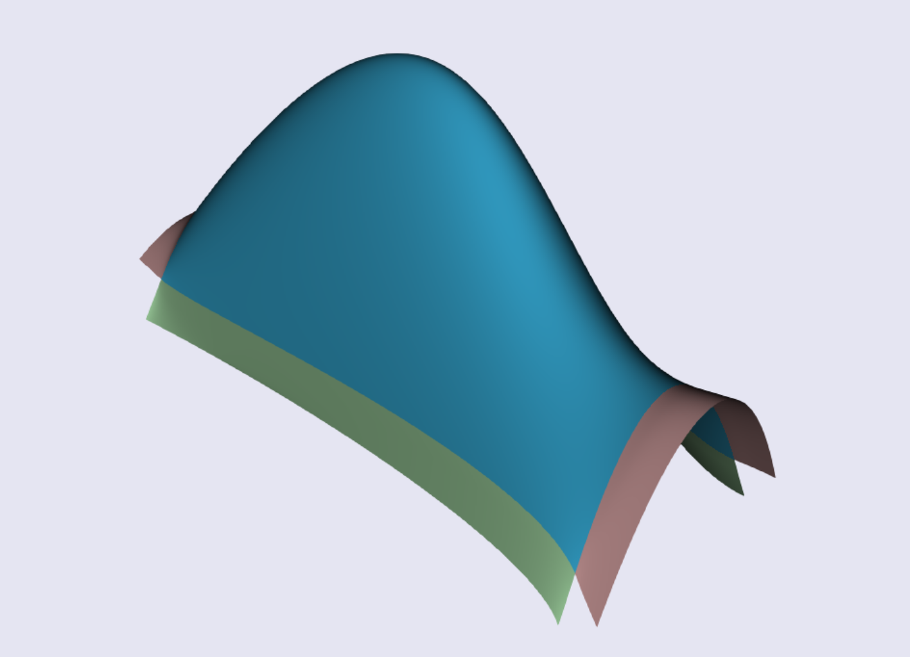
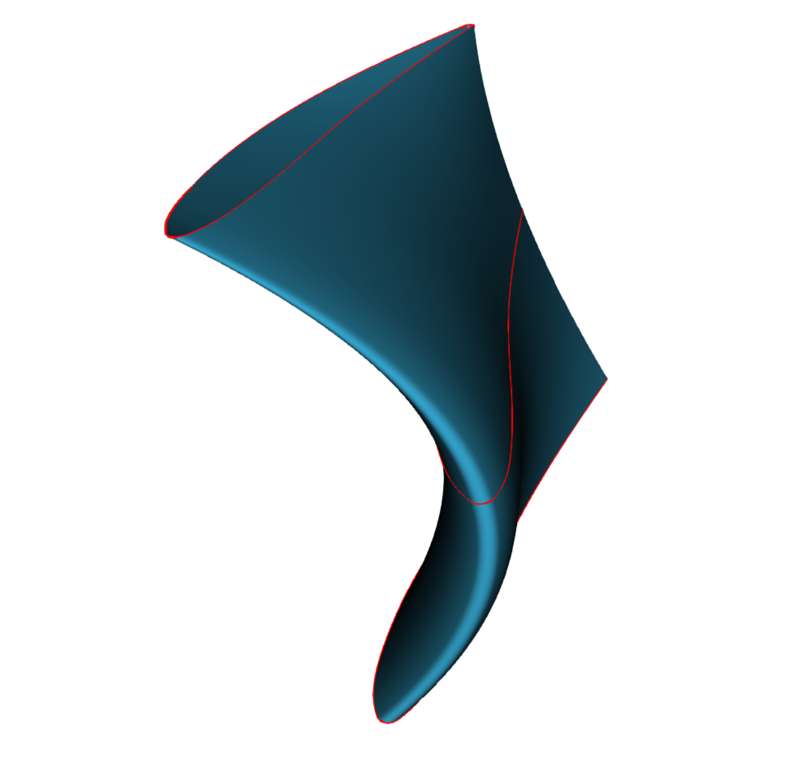

# GBS Release Notes
Unreleased

Features
* `gbs/intersect/projection.h`: closest points by Newton's method in any dimension (point-curve, point-surface, curve-curve, curve-surface) on bounded ranges: full Hessian (quadratic convergence also at a non-zero distance), Gauss-Newton where it is not positive definite, variables held on an active bound, step halved until the distance does not increase; global versions by subdivision (`global_point_curve`, `global_point_surface`, `global_curve_curve`, `global_curve_surface`): the pieces of the geometries (Bézier pieces of B-splines, enclosed by the boxes of their poles) are examined by increasing lower bound (boxes, slabs around their chords and planes), dropped when they cannot be closer than the best point found, halved until flat, and Newton starts from each flat piece, so that the global minimum is found where a grid of 30 samples missed it; sampled versions from the two nearest samples of a grid (surfaces outside 3D, projections inside the intersections). The extrema of `gbs/extrema.h` use the global versions; their `n_bracket` parameters are ignored for curves. First step of the removal of NLopt (`docs/sources/design/nlopt_removal.md`)
* `gbs-brep/pcurve.h`: exact pcurves of B-spline edges on planes (`plane_pcurve`): the poles mapped into the parameters of the plane, homogeneous coordinates kept for a rational curve, same knots; an edge following an iso line of a B-spline surface (a curve on it, as the edges of natural faces) is recognized as that B-spline (`detail::as_bspline`). Used when a face is built (`project_pcurve`), when faces are sewn, and by the imprint of coincident faces: the caps of a rational B-spline cylinder get pcurves of 9 poles instead of interpolations of 513
* `gbs/intersect/surface_surface.h`: the closed-form curves (lines, circles, ellipses) are restricted to the parameter boxes exactly: the carrier is cut at the apexes and poles it goes through, and on each span the roots of each coordinate of its pcurves minus the bounds of the box, repeated every turn for a periodic parameter, are found by Bézier subdivision in one dimension (touches included), instead of a sampling of 512 steps that could miss a part shorter than a step (a circle grazing a narrow face). Stage 2 bis completed (`docs/sources/design/brep_palier2bis.md`, review in § 12): 22 pairs of solids × 3 operations checked against OpenCascade
* `gbs-brep/section.h`, `gbs-brep/coincident.h`, `gbs-brep/boolean.h`: coincident faces of any surfaces (B-splines, a primitive and a B-spline of the same shape): detected by projecting a grid of points of each face on the surface of the other (faces touching along their borders when their intersection is singular there), imprinted with pcurves projected on the surfaces and seams read from the closure of the surface; edges lying on B-spline faces are imprinted the same way. Booleans of coplanar and stacked B-spline boxes, and of a box with planes against a B-spline box, checked against OpenCascade (operands converted to NURBS by OCCT)
* `gbs-brep/split.h`: a cut ending at a pole or an apex splits the degenerate edge there (`split_degenerate`), so that faces of spheres and cones are split by curves through their poles and apexes: booleans of a sphere centred on the side of a cylinder (both poles on the section), of Viviani's sphere and cylinder with the poles on the curve, of a cone cut through its apex (also when its seam lies on the cutting plane), checked against OpenCascade
* `gbs/intersect/marching.h`, `gbs-brep/section.h`: intersection curves crossing at branch points (equal crossed cylinders, the double point of Viviani's curve) are no longer `singular`: the marching steps straight over a branch point, onto the same branch beyond a dip of the angle between the normals (also when an ordinary step goes through it, recognized by n1 x n2 turning back, or when a seam passes through it), and reports the spans it stepped over (`IntersectionCurve::branch_spans`, Python `branch_spans`); the section crosses these spans and cuts the curves there, so that booleans of such solids work, with the numbers of solids and faces of OpenCascade. Tangencies along a curve still stop the marching
* `gbs-brep/boolean.h`, `gbs-brep/coincident.h`: booleans where an edge of one operand lies on a face of the other (a box resting on an edge, boxes touching along a part of an edge, the seam of a cylinder lying on a plane) instead of `NonGeneric`: `imprint_edge` splits the edge and the boundary of the face where they cross, merges the pieces running along the boundary with its edges and gives the pieces inside the face as cuts; same numbers of solids and faces as OpenCascade. `SectionResult::edges_on_faces` reports each edge lying on a face of the other shape with that face
* `gbs-brep/boolean.h`: booleans of solids touching at a point or along a line (sphere on a box, cylinder lying on a box, slivers touching along a line of tangency) instead of `NonGeneric`: contact points split nothing, edges of tangency are section edges that may stay inside a face they only touch, and where more than two kept faces meet at an edge they are paired around it (each with its neighbour across its material, tangent faces ordered by their curvature), every pair but the first getting its own copy of the edge so that shells stay manifold; same numbers of solids and faces as OpenCascade. First step of stage 2 bis (`docs/sources/design/brep_palier2bis.md`)
* `gbs-brep/classify.h`: `interior_points`, several interior points of a face; the position of a face against a solid uses the first one off the boundary of the solid
* Python: sub-module `gbs.intersect` (`curves`, `curve_surface`, `surfaces`) and stage 2 of `gbs.brep` (`classify`, `interior_point`, `section`, `split_face`, `split`, `boolean`, `fuse`, `cut`, `common`, `make_prism`, `make_revolution`, `offset_face`)
* Stage 2 of the native BREP checked by OpenCascade (`gbs-occt/tests/tests_brep2_occt.cpp`): 21 booleans (boxes, box and cylinder, box and sphere, crossed cylinders, coplanar, stacked and coaxial operands) give valid shapes with the volumes and numbers of faces of `BRepAlgoAPI`; sections have the lengths of `BRepAlgoAPI_Section`; prisms and revolutions the volumes of `BRepPrimAPI`
* `gbs-brep/sweep.h`: `make_prism` and `make_revolution` of an edge (face), a wire (shell) or a face (solid): each edge gives a natural face of its swept surface, a primitive when possible (plane, cylinder, cone, sphere, torus), the exact NURBS extrusion or revolution otherwise; edges on the axis sweep nothing; the caps are copies of the profile and the faces are sewn
* `gbs-brep/offset.h`: `offset_face`, the face at a distance along the normal of its surface, keeping its parametrization so that its pcurves are reused: exact offset primitives (a cone shifts its pcurves), `OffsetSurface` otherwise; the apex of a cone becomes a closed edge
* `gbs-brep/coincident.h`, `gbs-brep/boolean.h`: booleans with coincident faces (same plane, coaxial primitives of the same radius): the faces are imprinted on each other (edges split at their crossings, coincident vertices and overlapping edges merged, edges of one inside the other as cuts), and their coincident pieces are kept once or dropped according to the sides of the solids (stacked, shifted, identical boxes; coaxial cylinders)
* `gbs-brep/boolean.h`: boolean operations on solids (`fuse`, `cut`, `common`, `boolean(op, a, b)`), on copies of the operands: section, split of the faces of both copies by the same edges, classification of every face against the other operand, selection, assembly of shells by shared edges and of solids with their cavities; generic configurations only, the others (coincident or tangent faces, edges or vertices on the other operand, singular intersections) give the new `BuildErrc::NonGeneric`
* `gbs-brep/split.h`: `split_face` splits a face by edges crossing it, in its parameter space (boundary edges split where cuts end on them, in every wire using them; arrangement of half-edges with the two sides of a seam as distinct nodes; loops of positive area as outer boundaries, holes given to the smallest loop containing them; dangling cuts reported); the pieces share the surface and replace the face in its shells. `split(shape, tool)` splits the faces of a shape along its section by a shape or a surface: solids stay closed
* `gbs-brep/section.h`: section of two shapes, or of a shape by a surface: the edges where their faces meet, with their pcurves on both faces, restricted to the inside of both faces, sharing the vertices of the shapes within the tolerance, chained into closed or open wires in a compound; edges of the shapes lying in the section (along a face boundary) and coincident faces reported
* `gbs-brep/classify.h`: position of a point against a face, in its parameter space (ray crossed with the pcurves of the wires), and against a solid with its cavities (ray crossed with the faces); `On` within the tolerance of the boundary; ambiguous rays (through a vertex or an edge, tangent, along a face) retried in a fixed sequence of directions; `interior_point` of a face and position of a face against a solid
* `gbs/intersect/marching.h`: intersection of any two surfaces by marching: starting points from the subdivision of both surfaces into flat patches, prediction along n1 x n2 and Newton correction in the plane normal to the step, step adapted to the turn of the tangent, landing on the boundaries of the boxes, closed loops, singular points (tangency, branch point) flagged; curves as cubic B-splines with their two pcurves on the same parameter, densified until within the tolerance. `intersect(s1, box1, s2, box2)` now handles every pair (`IntersectOptions::closed_forms` to force marching); results in `gbs/intersect/intersection_curve.h` with `SurfaceSurfaceResult::singular`
* `gbs/intersect/surface_surface.h`: intersection of two surfaces on parameter boxes, as curves carrying a 3D curve and a pcurve on each surface on the same parameter, contact points and coincidence. Pairs of primitives with a closed form (`gbs/intersect/analytic_surfaces.h`): two planes, plane and cylinder or cone (circle, ellipse, generatrices), plane and sphere, two spheres, coaxial surfaces of revolution (circles from their meridians), plane through the axis of a torus, cylinders of parallel axes; exact lines, circles and ellipses restricted to both boxes and cut at their seams, pcurves exact when linear, interpolated otherwise with their deviation. Other pairs are marked incomplete until the marching algorithm
* `gbs/intersect/curve_surface.h`: intersection of a curve and a surface on bounded ranges, giving every crossing and every portion of the curve lying on the surface. Closed forms for a line against the primitives (quadratic, quartic for the torus) and for a circle or an ellipse against a plane; otherwise subdivision of the curve against Bézier patches of B-spline surfaces (or sampled patches of other surfaces) and Gauss-Newton on (t, u, v). Tangent crossings are flagged (`gbs/intersect/surface_pieces.h`, `gbs/intersect/polynomial.h`)
* `gbs/intersect/curves.h`: intersection of two curves on bounded parameter ranges (any dimension), giving every crossing and every common portion: B-splines are cut into Bézier segments enclosed by the box of their poles and halved by de Casteljau, other curves are sampled; pairs of flat pieces are refined by Gauss-Newton. Tangent crossings are flagged and told apart from overlaps, closed curves are handled at their seam. First step of stage 2 of the BREP kernel (`docs/sources/design/brep_palier2.md`)
* `gbs/intersect/box.h`: `gbs::Box<T, dim>`, axis-aligned bounding box, and `segment_overlaps` (slab test)

Fixes
* `gbs/extrema.h`: `extrema_curve_point`, `extrema_surf_pnt`, `extrema_curve_curve`, `extrema_curve_curve_lst` and `extrema_surf_curve` returned the square of the distance (the squared distance was squared again by `solve_D_nlop`). They now return the distance, so that the contact checks of `build_intersections` (thus `gordon`), of the TFI lattices (`gbs-mesh/tfi.h`) and the choice of the projection in `gbs-brep/pcurve.h` compare a distance to their tolerance (curves 1e-4 apart passed a check at 1e-6), and `dev_from_points` returns distances. **Breaking:** these checks are now as strict as their tolerance says, as the grid check of `gordon` already was (at `tol` = 1e-6, `build_intersections`, `lattice_intersections` and `tfi_mesh_2d` accepted curves up to 1e-3 apart, now up to 1e-6): pass a larger `tol` for curves that do not meet exactly. The extrema are computed by Newton's method instead of NLopt's COBYLA, with the second derivatives: a curve or a surface whose `value()` throws beyond the first derivatives must now override the new `has_second_derivatives()` to return false (as `brep::OffsetSurface` does), Gauss-Newton is then used (**breaking** for such user classes, which used to work): the `solver` parameter (Python `solver=`, which now warns) is ignored and will be removed with NLopt. The bracketed overloads start Newton from the two nearest samples (closed curves and surfaces), `extrema_surf_pnt` and `extrema_surf_curve` without a start throw `std::invalid_argument` on an unbounded surface, `extrema_curve_curve_lst` passes its `n_bracket_u` / `n_bracket_v`, and the gradient of the surface-curve problem (wrong arguments of the surface derivatives) is gone
* `gbs/intersect/marching.h`: a curve touching the boundary of a box where it leaves the other surface (the circle of a cap on the box of its plane disk, at the seam of the side) landed on that boundary, tangentially, and stopped a few 1e-6 short, so it was not closed: a landing where the curve only touches the bound (sine of its angle with the iso under `angular_tol`) is passed over for the next parameter to leave its box, started inside the boxes
* `gbs/intersect/marching.h`: a curve running along the border of a B-spline surface (the plane cap of a B-spline cylinder against its side) came out as a score of wrong branches: a predicted point beyond the bound by a rounding error (v = -3e-34) was taken as leaving the surface and returned without being corrected, so the marching accepted points 1e-2 off the intersection. Parameters beyond a bound by less than the rounding margin of the boxes (1e-10 (1 + |a| + |b|)) are put back on it before that test too, so that a point left beyond is out of the box and the marching lands; the boolean of a B-spline cylinder with its copy goes from 6.1 s to 2.3 s
* `gbs-brep/split.h`: a hole sharing edges with another loop (the outline of two regions touching along a line, around both of them) could be given to that loop, its first point lying on its boundary; the outer region then lost its hole, and a boolean of a box tangent to a cylinder could leave an open shell for a change of 1e-13 in a parameter. The point tested is now taken beside the hole, on the left of its polygon where the face owning it lies, half way to the nearest boundary in that direction (whatever the thickness of the face)
* `gbs/bscurve.h`, `gbs/intersect/curve_pieces.h`, `gbs/intersect/surface_pieces.h`: `bezier_poles`, the Bézier decomposition of a clamped B-spline by the algorithm A5.6 of The NURBS Book (all the interior knots raised to the degree at once, nullopt for a discontinuity), used for curves and, row by row then column by column, for surfaces instead of one knot insertion at a time, quadratic in the number of knots: the boolean of a rational B-spline cylinder with its copy goes from 63 s to 6 s
* `gbs/intersect/curves.h`, `gbs/intersect/curve_surface.h`: the projection of a point on a curve stopped on its nearest sample when Newton's denominator was negative (rational parametrizations), and on a closed curve or surface could start from the wrong end of the seam and stay against the bound (a point of a rational circle found 0.39 away from it); Gauss-Newton steps are used instead, from the two nearest samples
* `gbs-brep/coincident.h`: pcurves projected on B-spline surfaces are accepted within the approximation tolerance of the pcurves, the edge tolerance being raised to their deviation (the parametrization of a rational surface is only C1 at its knots); an edge crossing the seam of a closed B-spline face is split there
* `gbs/intersect/marching.h`: a curve running along the border of a B-spline surface failed at its ends: its interpolated pcurves went beyond the parametric rectangle (now kept inside it), parameters beyond the bounds by a rounding error were taken as leaving the surface (now put back on the bound), and the landing on a box chose a parameter out of its box only by a rounding error, with a negative ratio (now ignored); such curves were flagged singular, so that booleans of B-spline boxes failed
* `gbs-brep/classify.h`: parameters inside the rounding margin of the bounds were evaluated beyond them, which a B-spline surface refuses
* `gbs/intersect/surface_surface.h`: the pcurve of a closed-form curve ending at the apex of a cone (or at a pole) took there the angle of another generatrix and ran diagonally in (u, v); the angle at a singular sample is now extrapolated from its neighbours
* `gbs-brep/split.h`: a hole loop could be given to its twin, the outer loop made of the same edges (a rectangle cut in a plane, a point of its boundary found inside its own outline), leaving a face of zero area and making booleans fail ("a face without inside") for a box whose face contains the axis of a cylinder
* `gbs-brep/classify.h`: parameters a rounding error outside the bounds of the surface (0 against 2.4e-16 read from a file) were outside the face before the test of its boundary, so that an edge lying on a seam was not seen
* `gbs-brep/boolean.h`: the faces of the copies of the operands that the result does not keep stayed in the model (they were listed after their shells were erased), as did the edges and vertices of the attempt when an operation failed; edges and vertices created by an operation and not used are now erased
* `gbs-brep/section.h`: a small arc of a curve tangent to the boundary of a face was reported as an edge lying on the face; a piece near the boundary is now an edge of the boundary only where the curves overlap
* `gbs/intersect/marching.h`: a branch reduced to a point where the surfaces are not tangent (a start on both seams at once) was reported as a contact point, so that two OpenCascade cylinders crossing on their seams made the booleans refuse them; only tangent contacts are points now
* `gbs-brep/sweep.h`: a face with holes turned completely sweeps cavities: the solid is closed by the largest shell, the others are its voids
* `gbs-brep`: `bounding_box` of a face bounded by its wires only covered its edges, so a sphere bounded by its seam got the box of a half circle; the surface is now sampled over the box of the pcurves of every face. The filters of `section` and of the point/solid `classify` also grow their sampled boxes by 5 % of their size, and `classify` tests whether a point lies on a face before casting a ray (a ray starting on a surface could miss it by rounding)
* `gbs-brep`: a pcurve projected from an edge lying on the border of a surface could overshoot the parametric rectangle by rounding errors and make surface evaluations throw; its poles are now kept inside the rectangle
* `gbs-brep`: the global projection of a point on a surface (first sample of a projected pcurve) could stop in a local minimum on the opposite border of a closed surface for a point just before its seam; it now restarts Gauss-Newton from the nearest node of a grid when the first result is not on the surface
* `IgesWriter::add_geometry` (`gbs-io/iges.h`) wrote rational curves and surfaces with their homogeneous poles `(w x, w y, w z)` as control points, so circles, ellipses and rational surfaces were read back distorted, and 2D curves with a wrong coefficient stride; poles are now written as Cartesian points plus weights, 2D geometry with z = 0 (the NURBS writers of the BREP export moved to `iges.h` and are shared); checked by an OpenCascade round trip
* `add_dimension` of a rational curve or surface put the new coordinate in place of the weight (homogeneous poles `(w x, w y, w)` became `(w x, w y, w, val)`), giving a zero weight by default; the new coordinate is now inserted before the weight as `w val` (`add_dimension_homogeneous` in `gbs/transformpoints.h`); non-rational geometry is unchanged
* `Line::bounds()` returned `{numeric_limits<T>::min(), max()}`, i.e. a lower bound of ~2.2e-308 instead of an unbounded line: negative parameters were rejected by bounds checks and point projections were clamped at u ≈ 0. It now returns `{lowest(), max()}`; `solve_N_nlop` / `solve_D_nlop` pass such bounds to NLopt as ±∞ (unbounded variable), since a finite `max() - lowest()` overflows NLopt's initial step. The extrema overloads that bracket their initial guess by sampling the bounds (`extrema_curve_point`, `extrema_curve_curve`, `extrema_surf_curve` without u0) now throw `std::invalid_argument` on an unbounded range instead of sampling NaNs: pass an initial guess or trim the line

Build / tooling
* the legacy topology classes `BaseTopo`, `Vertex`, `Edge`, `Wire` of `inc/topology/` (headers `basetopo.h`, `vertex.h`, `edge.h`, `wire.h`) are removed in favour of `gbs::brep`; the half-edge mesher tests build their boundaries with `gbs::brep` wires
* the library now requires C++23 (was C++20): `CMAKE_CXX_STANDARD 23`. Supported toolchains are those of the CI (clang >= 19, MSVC 2022, AppleClang >= 17); the library-only C++23 features that Apple libc++ lacks (`std::flat_map`, `std::print`, `std::mdspan`) are not used

New features
* STEP writer validated against OpenCascade: the 20 shapes and the assembly of the reader comparison go through OCCT → gbs → STEP → OCCT with valid shapes and the same counts and volumes, without approximation; shapes built in gbs read by OCCT. Python: `gbs.brep.write_step(model, shapes, path, schema="AP214", approx_tol, pcurves, flatten, uncertainty, product_name, author, organization)` → `StepWriteReport`, `write_step_text` → `(text, report)`
* `gbs-io/step/writer.h`: STEP writer — `write_step(model, shapes, options)` / `write_step_file` write solids (with cavities), shells and faces as parts and compounds as assemblies whose shared parts are written once with the placements of their occurrences (`Model::instance`), or one flattened part; topology as in the model with pcurves (`surface_curve`, `seam_curve`), degenerate edges left out, face senses through `same_sense`; AP214 or AP242; `StepWriteReport`; every reading test file survives a read / write / read round trip unchanged
* `gbs-io/step/geometry_writer.h`: STEP writer, geometry layer — primitives written as analytic entities (line, circle, ellipse, plane, cylindrical, conical, spherical, toroidal surfaces), B-splines exactly (rational as complex instances, Cartesian poles and weights, curves restricted to the edge range, surface grids transposed), iso lines of natural faces exactly, 2D segments as lines, other geometry approximated with the parameter preserved; representation context in the model unit (mm, cm, m, µm, inch, foot or any) with radians and the uncertainty. The approximation shared with the IGES export moves to `gbs-io/to_nurbs.h`; `ElementarySurface::iso_v`
* `gbs-io/step/p21_writer.h`: writer of the STEP Part 21 exchange structure (first layer of the STEP writer): `P21Value` (references, integers, reals written in their shortest exact form whatever the locale, UTF-8 strings encoded as `\X2\` / `\X4\`, enumerations, logicals, lists, typed values), `P21Writer` with simple and complex instances (partial entities sorted), header and schemas, readable line wrapping
* `gbs-brep`: provenance of assembly instances — `Model::newPart`, `setInstance` / `instance` (`InstanceOf`: part key and placement), kept by `erase`, `compact`, `append` (part keys shifted) and composed by `copy_shape`; the STEP reader records it for every product it reads, so that a writer can share parts; `Placement` moved to `gbs-brep/placement.h`; Python bindings
* `gbs/primitives.h`: analytic primitives with the STEP parametrizations on a finite domain — `Plane`, `CylindricalSurface`, `ConicalSurface`, `SphericalSurface`, `ToroidalSurface`, `LineCurve`, `EllipseCurve` (arcs may cross the angle 0) — with exact derivatives, closed-form inverse, iso lines, rigid moves and exact NURBS conversion; usable in the native BREP beside NURBS (natural faces, faces from wires, solids, `copy_shape`); the STEP reader now keeps lines, conics and elementary surfaces analytic; the global projection on a primitive starts from its closed-form inverse; Python bindings
* Python: `gbs.brep.read_step(model, path, target_unit_mm=None, strict=False, max_tolerance=1e-2, face_options=...)` and `read_step_text` return `(root, report)` (`StepReadReport`, `StepIssue`), raising `BRepError` when the reading fails; `Placement` and `copy_shape` bindings. Doxygen / Sphinx documentation of `gbs-io/step`, `gbs-brep/edit.h` and `gbs/bselementary.h`; STEP example in the ReadMe
* STEP reader: assemblies flattened into named compounds — products, `next_assembly_usage_occurrence` placed by `item_defined_transformation`, sub-assemblies and `mapped_item`s; each occurrence is a placed copy of its part (a part is read once); checked against OpenCascade. `gbs-brep/edit.h`: `Placement` (rigid placement) and `copy_shape(model, shape, placement)`, a transformed copy keeping the shared topology and the pcurves
* STEP reader validated against OpenCascade (`gbs-occt/tests/tests_step_occt.cpp`): 20 shapes written by `STEPControl_Writer` (primitives, booleans, fillets, revolutions, extrusion, loft) read by gbs and OCCT with the same numbers of faces, edges and vertices and the same volumes; the reader now reads a face without edge loop as its whole surface, starts the box of a full-turn face at the file's seam edge, and takes the face normal from `same_sense` (the region from the geometry)
* `gbs-brep/edit.h`: `split_edge(model, edge, u)` splits an edge at a parameter, updating every wire using it (the two halves share the curve and the co-edge pcurves); Python binding. STEP reader: a face turning around its surface without seam edge (band between two circles, spherical cap, cone bounded by its base) gets a seam, the iso-u line of its NURBS at an angle avoiding its holes, the edges it meets being split
* `gbs-io/step/reader.h`: STEP reader — `read_step(model, text)` / `read_step_file(model, path)` read the solids (`manifold_solid_brep`, `brep_with_voids`) and open shells (`shell_based_surface_model`) of AP203 / AP214 / AP242 files into a `gbs::brep::Model<double>`, keeping the topology of the file (vertices and edges shared by `#id`, ordered loops, face senses), exact NURBS geometry and recomputed pcurves, lengths converted to the model unit; names, product names and `#id`s kept; partial import with a `StepReadReport` (unsupported entities, failed faces, tolerances, `check()`), or strict mode leaving the model unchanged; `BuildErrc::InvalidFile` and `UnsupportedEntity`
* `gbs-brep`: `make_wire_ordered` builds a wire from co-edges given in order and sense (topology read from a file), an edge being allowed twice in opposite senses (seam); `make_face_use` returns the `FaceUse` keeping the senses of the given wires (Reversed when the outer wire had to be turned counter-clockwise in (u,v)); the face-from-wires builder puts co-edges lying on a seam on the side of their neighbours (both uses of a seam edge on opposite sides) and inserts degenerate co-edges where two co-edges meet at a pole (sphere, cone apex); Python bindings
* `gbs-io/step/geometry.h`, `gbs-io/step/units.h`: translation of STEP geometry (second layer of the STEP reader) — `read_units` (SI and conversion based length and angle units, distance uncertainty, conversion to a target unit), `GeometryReader` reading placements, curves (line, circle, ellipse, B-spline with knots / Bezier / quasi uniform / uniform, rational, polyline, trimmed, composite, surface and seam curves) and surfaces (plane, cylinder, cone, sphere, torus, revolution, extrusion, B-spline, rectangular trimmed, offset of elementary surfaces) into definitions in the STEP parametrization with analytic inversion, converted to exact NURBS over a parameter range (`to_nurbs`); `parameter_box` bounds the surface of a face from its boundary; unclamped (periodic) knot vectors are clamped exactly; `StepError` / `StepUnsupported` carry the offending `#id`
* `gbs/bselementary.h`: exact rational NURBS of conic arcs and elementary surfaces, with the STEP (ISO 10303-42) parametrizations — `build_circle_arc` / `build_ellipse_arc` between two angles in a frame (parameter equal to the angle at the knots, exact conversion by `ellipse_arc_parameter` / `ellipse_arc_angle`), `build_revolution` (rational revolution of a NURBS around an axis), `build_extrusion`, `build_cylinder`, `build_cone`, `build_sphere`, `build_torus`; Python bindings
* `gbs-brep`: model attributes — `setName` / `name`, `setExternalId` / `externalId` (e.g. the STEP `#id`), `setUnitScale` / `unitScale` (millimetres per model unit); kept in sync by `erase`, `compact` and `append` (which refuses models of different units); IGES export labels a face with its own name; Python bindings
* `gbs-io/step/p21.h`: reader of the STEP Part 21 exchange structure (first layer of the STEP reader): `parse_p21` / `read_p21` return the instances (simple and complex), header and schemas, with typed values, UTF-8 decoded strings, a type index and syntax errors located by line and column (`std::expected`)
* `gbs-brep` (stage 1 of the native BREP core, design in `docs/sources/design/brep_core.md`): `gbs::brep::Model<T>` arena with typed identifiers (`Id<ShapeType>`: `VertexId`, `EdgeId`, …) and the BREP entities (`Vertex`, `Edge`, `CoEdge`, `Wire`, `Face`, `FaceUse`, `Shell`, `Solid`, `Compound`), orientation by usage, pcurves per co-edge, per-entity tolerances; `erase` / `compact` / `append`; constants `brep_default_tolerance` and `brep_pcurve_approx_tol` in `gbs/gbsconstants.h`
* `gbs-brep/explore.h`: `explore(model, shape)` (sub-entities by type, no duplicate), `TopologyIndex` (faces / co-edges of an edge, edges of a vertex, shells of a face), wire `is_closed` / `is_chained`, shell `is_closed` / `is_manifold` / `is_orientable` / `free_edges` / `non_manifold_edges` / `shell_edge_uses`, `bounding_box` with a `BoundingBox` type
* `gbs-brep/builders.h`: `make_vertex`, `make_edge` (curve with or without bounds, two points, two vertices, curve ending on given vertices), `make_degenerate_edge`, `make_wire` (edges in any order and sense, vertex merge within tolerance, open or closed chain); builders return `BuildResult<Id>` = `std::expected<Id, BuildError>` and leave the model unchanged on failure, `unwrap()` throws `BRepError`
* `gbs-brep`: `make_face(model, surface)` builds a face on the whole parametric rectangle, with seam edges (cylinder, full revolution, torus) and degenerate edges (sphere poles, cone apex), exact `CurveOnSurface` edges and degree-1 pcurves; `surface_closure` (numeric closure / degeneracy of the four boundary isos) and `uv_signed_area` in `gbs-brep/closure.h`
* `gbs-brep`: `make_face(model, surface, outer_wire, holes)` builds a trimmed face from free wires of 3D edges, and `make_face(model, surface, outer_pcurves, holes_pcurves)` from loops of 2D curves; pcurves are extracted exactly from `CurveOnSurface` edges on the same surface, otherwise projected (Gauss-Newton) and interpolated at the edge parameters until `pcurve_tol` (`gbs-brep/pcurve.h`), continuous across seams and poles; outer boundary turned counter-clockwise, holes clockwise and checked inside
* `gbs-brep/check.h`: `check(model, shape)` reports every violated invariant of a shape (dead references, tolerances and their vertex >= edge >= face order, vertices off curves, degenerate edges, wire chaining and closure, pcurve presence, range and SameParameter, outer / hole orientation, inclusion and overlap in (u,v), non-manifold, open or non-orientable shells) without modifying the model nor throwing
* `gbs-brep/sew.h`: `sew(model, faces)` merges free edges whose ends coincide and whose curves stay within the sewing tolerance of each other (sampled both ways), rebuilds the absorbed co-edge pcurves in the surviving edge's parameter, merges vertices, absorbs gaps in the tolerances, and returns one consistently oriented shell per connected component with a report (merged, free, rejected and ambiguous edges, orientability); no edge cutting
* `gbs-brep`: `make_solid(model, outer, voids)` turns a closed, consistently oriented outer shell outwards and the cavity shells inwards using `signed_volume` (divergence theorem integrated over the (u,v) region of each face, in `gbs-brep/closure.h`); `make_compound`; `check` reports `SolidNotOutward` and `VoidNotInward`
* `gbs-io/iges_brep.h`: `add_brep(writer, model, shape, name, options)` writes the faces of a native BREP shape as IGES trimmed surfaces (144 over 128, boundaries as 142 with 102 composites of 126 pcurves and 3D curves, co-edge order and sense), free edges as 126; NURBS written exactly (rational poles converted to Cartesian points and weights), other geometry interpolated at its own parameters within `approx_tol`; `scale` option; checked by an OpenCascade round trip
* Python: sub-module `gbs.brep` binding the native BREP core (model with typed identifiers, explorer and `TopologyIndex`, queries, `make_vertex` / `make_edge` / `make_wire` / `make_face` / `make_face_from_pcurves` / `sew` / `make_solid` / `make_compound` raising `gbs.brep.BRepError` on failure, `check`), and `IgesWriter.add_brep`; the gbs-brep headers are in the Doxygen documentation
* `arc_length_distrib_params`: curve parameters at prescribed normalized arc lengths, given as a list or as a law s(ξ) of the node index fraction ξ = i / (n − 1) (tanh, geometric… clustering in length on the original curve, without re-interpolating it); `uniform_distrib_params` is the law s(ξ) = ξ. Python bindings for both forms

v0.5.1 — 30 sep 2026

Fixes
* MSVC builds no longer force `/fp:fast /arch:AVX2` (#109): `/fp:fast` broke the robust geometric predicates (`orient2d`) used by the Delaunay mesher, and `/arch:AVX2` made the binaries require an AVX2 CPU. MSVC keeps its defaults (`/fp:precise`, SSE2); `GBS_MSVC_FAST_MATH=ON` restores the old flags for local builds
* CI builds and tests with MSVC on Windows, like the conda-forge win-64 package

v0.5.0 — 29 sep 2026

Behaviour changes
* loft: the skin-direction (v) parameters now default to the averaged chord-length of NURBS Book §10.3 instead of a uniform parametrization (#71) — lofted surfaces differ from 0.4.x for the same input
* `find_span` now follows NURBS Book A2.1 exactly (half-open convention `k[s] <= u < k[s+1]`, #42/#46): correct one-sided derivatives at knots of multiplicity > 1

Performance
* evaluation: allocation-free O(p²) evaluator and one-pass multi-order derivatives (#30); span reduction enabled for derivatives (~12x faster curve derivatives); per-call eval ~4x faster than OCCT
* bulk evaluators are parallel above a size threshold (#88, 12–30x over OCCT's scalar loop); grid sampling (`offset_points`, surface `discretize`) pre-sized and parallel (#89)
* Python: bulk evaluators return numpy arrays without copy (#97, ~10x at 1M points)
* interpolation: banded / sparse / separable solves (#34), then direct band assembly + no-pivot band LU (#96): ~10x on an 800-point build, now faster than OCCT and scipy at every tested size
* approximation: banded one-pass assembly and structured least-squares solve (#65, 2.5–9x vs OCCT)
* loft: v-system factorized once, batched pole solves (#40)
* new `build_batch` (`gbs/execution.h`): builds N independent interpolations/approximations in parallel, exceptions propagated to the caller (#91)
* mesh: `elliptic_structured_smoothing` sweeps rows in parallel, bit-identical to the serial loop (#90, 5x at 10k and 16x at 1M interior vertices on 64 cores)

New features
* degree reduction (NURBS Book A5.11, #78): `BSCurve::reduceDegree(tol)`, `BSSurface::reduceDegreeU/V(tol)` return (success, rigorous error bound) and leave the geometry untouched when not reducible within `tol`; Python bindings, plus `BSSurface.increaseDegreeU/V`
* hodograph (NURBS Book A3.3, #83): `derivative_curve(crv, k)` returns the k-th derivative of a non-rational curve as a `BSCurve` (C++ and Python)
* rational surface derivatives (NURBS Book A4.4, #33)
* spine-guided rational loft, and `loft_approx` (well-posed loft by approximation, #58/#63)
* vectorized derivatives w.r.t. curvilinear abscissa: curves `d_dms` / `d_dm2s`, surfaces `d_dmus` / `d_dmvs` / `d_dmu2s` / `d_dmv2s`
* Python bindings: `d_dm` / `d_dm2` (curves) and `d_dmu` / `d_dmv` / `d_dmu2` / `d_dmv2` (surfaces) accept a list of parameters
* `pygbs.gbs.__version__`; the installed CMake package now carries its version (`find_package(GBS 0.5)`)

Fixes
* `remove_knot` faithful to NURBS Book A5.8 for `num > 1` (#59)
* `refine_approx` stop criteria and pole-count guards (#65)
* rational `loft` with spine compiles and interpolates; rational `flat_v` overload returns a surface (#40/#58)
* hardened Bowyer-Watson cavity construction in the 2D Delaunay mesher (#48)
* gbs-occt: OpenCASCADE 8 support (7.x still supported), 2 runtime divergences fixed (#47)
* Python: `elliptic_structured_smoothing` ignored `n_it` and `tol` (a single sweep was done); `BSSurface.reverseV` reversed U; `vistaplot` ready for pyvista 0.50 (`copy(deep=...)`)

Build / tooling
* tests migrated from GoogleTest to doctest; test executables are no longer installed
* tuning constants centralized in `gbs/gbsconstants.h` (#38)
* optional precompiled headers (`GBS_USE_PCH`), coverage build (`GBS_COVERAGE`)
* CI on Linux, Windows, macOS arm64 (+ Intel, non-blocking) and OCCT 7/8
* the in-repo conda recipe is removed: gbs is packaged by conda-forge (gbs-feedstock)
* audit reports and benchmarks under `bench/` (NURBS Book fidelity, interpolation, approximation, parallelization, OCCT/scipy/geomdl comparison)
11 oct 2022
* surfaces iso parametric curves
08 mar 2022
* Gordon surface
* constrained surface approximation/interpolation
* add gcc support
* tfi mesh
* increase python wrapping
10 sep 2021
* add name support for iges export
* add function object
* extend Python biding
* add jupyter render

22 may 2021
* add curve and surfaces extension
* add surfaces of revolution
* add igest export support
* many fixes and improvements

11 apr 2021
* curves creation from json
* transfinite mesh
* curvature base discretization
* curvilinear abscissa
* curve reparametrization
* cn curves connections
* surface approximation
* curves 2d offset
30 nov 2020
* Add many utilities to connect and join curves.
* Improve render configuration.
* Put everything together to build advanced shape

31 oct 2020
* Loft surface creation

12 oct 2020
* Start python biding

08 oct 2020
* Geometries have now a 3d visualization

01 oct 2020
* Initial public release.