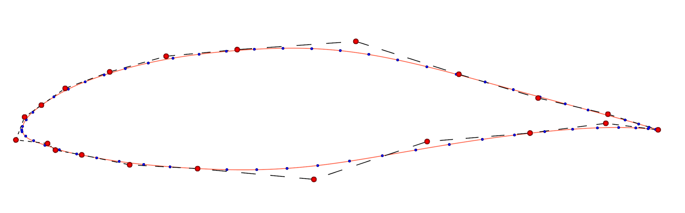
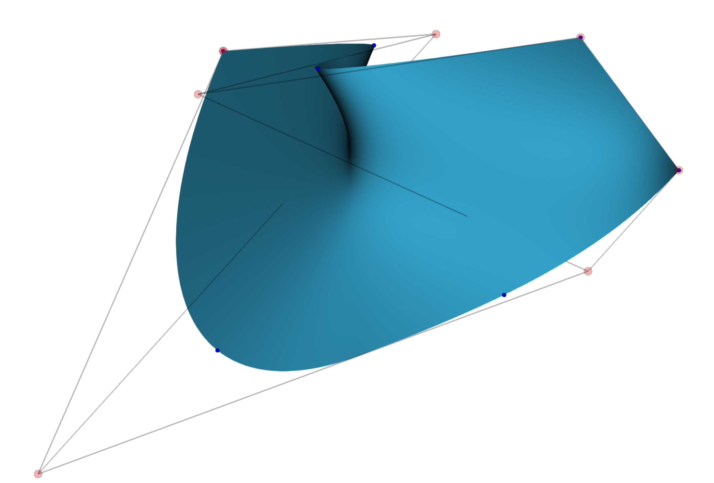
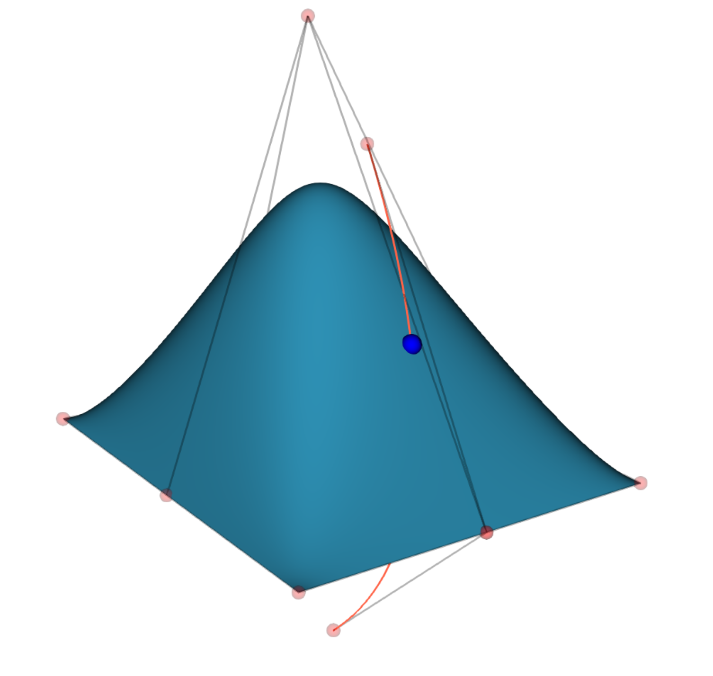
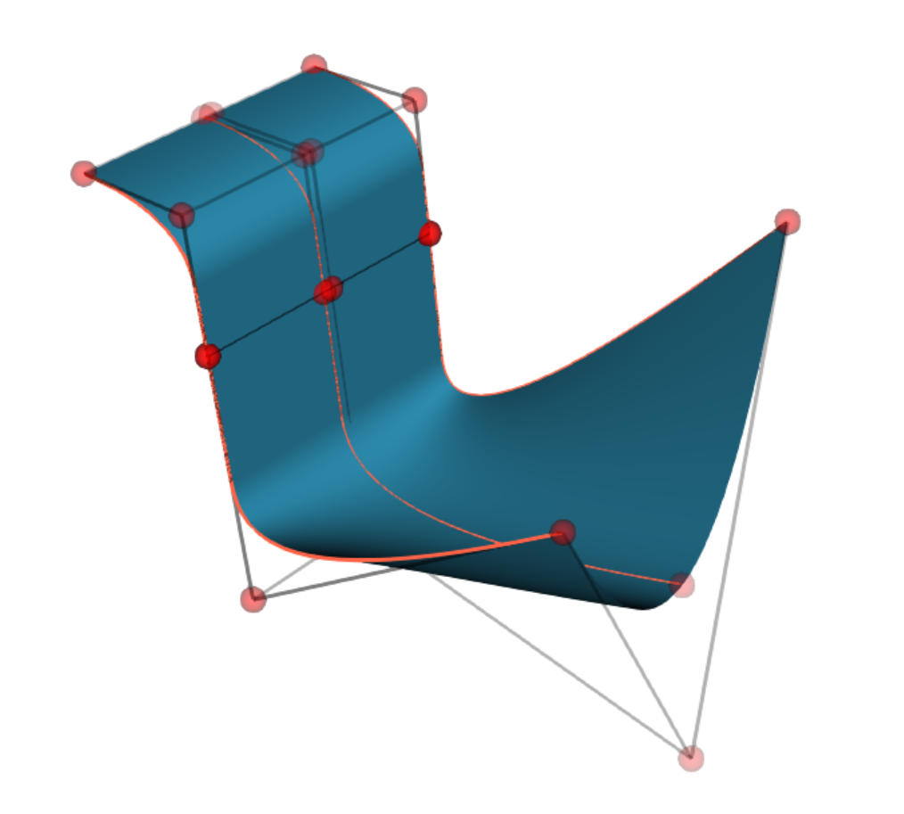
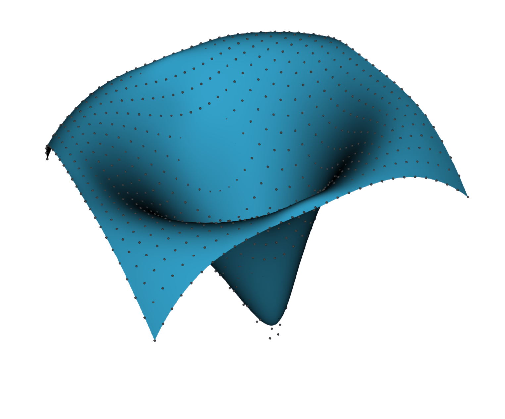
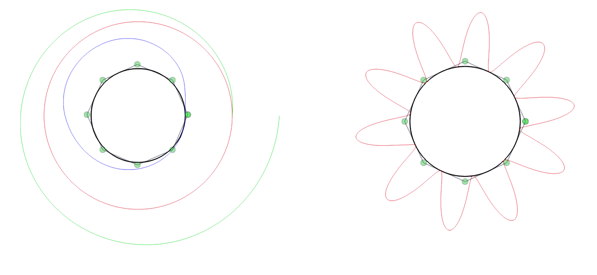
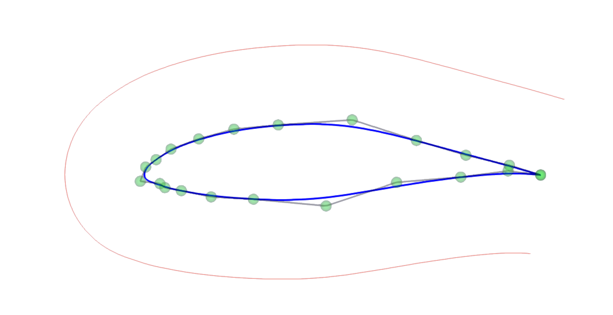
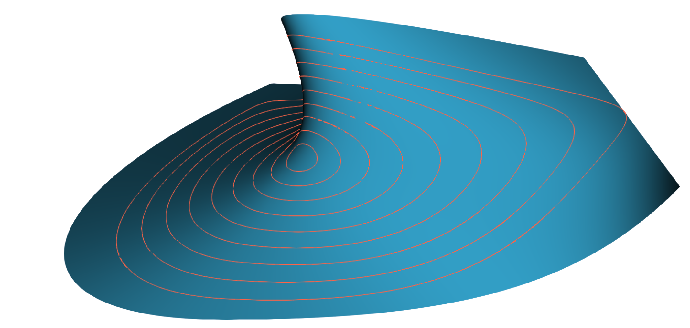

GBS is header library for computing bspline curves and surfaces.

GBS is compatible with OpenCASCADE, curves and surfaces can be converted to OpenCASCADE's objects.

__Example of point cloud approximation:__


__Example of points surface interpolation:__


__Example of curve-surface intersection:__


__Example of loft-surface creation:__


__Example of surface approximation of points:__



__Example of curve 2d variable offset:__



__Example of curve on surface:__


__Example of python code to interpolate points__
```python
    pts = [
        [0.,0.,0],
        [0.,0.,1],
        [1.,0.,0.5],
        [1.,1.,1]
    ]
    constraints = []
    for p in pts:
        constraints.append([p])

    degree = 2

    crv = gbs.interpolate_cn_3d_d(
        constraints,
        degree,
        gbs.KnotsCalcMode.CHORD_LENGTH
    )
```
__Example of python code to read a STEP file into the native BREP__
```python
    brep = gbs.brep
    m = brep.Model()
    root, report = brep.read_step(m, "part.stp")   # lengths converted to millimetres
    print(report)                                  # solids, faces, unit, unsupported and failed entities, validity
    for s in brep.explore_solids(m, root):
        print(m.name(s), brep.signed_volume(m, m.solid(s).outer))
```
__Example of python code to write a STEP file__
```python
    report = brep.write_step(m, root, "copy.stp")  # solids as parts, compounds as assemblies sharing their parts
    print(report)                                  # parts, assemblies, solids, faces, approximations
```
The reader and the writer are header-only (`gbs-io/step/reader.h`, `gbs-io/step/writer.h`, no dependency beyond gbs):
AP203, AP214 and the BREP part of AP242 are read, AP214 or AP242 written; planes, cylinders, cones, spheres and tori
stay analytic, B-splines exact, assemblies flattened into named compounds that keep the provenance of their instances.
Checked against OpenCascade both ways.

__Example of python code for booleans, sections and sweeps on the native BREP__
```python
    a = brep.explore_solids(m, root)[0]
    tool = brep.make_prism(m, disc_face, [0., 0., 20.]).shape   # extrusion of a face: a solid
    result = brep.cut(m, a, tool)                                  # also fuse, common; the operands are kept
    print(len(result.solids), brep.check(m, result.shape).ok())
    plane = gbs.Plane([[0., 0., 5.], [0., 0., 1.], [1., 0., 0.]], [-100., 100., -100., 100.])
    section = brep.section(m, result.shape, plane)                 # edges with their pcurves, chained into wires
    hits = gbs.intersect.surfaces(surface_1, surface_2)            # curves, contact points, coincidence
```
Booleans, sections, splits, extrusions and revolutions (`gbs-brep/boolean.h`, `section.h`, `split.h`, `sweep.h`,
`offset.h`) build on exact intersections (`gbs/intersect/`: closed forms for the primitives, marching otherwise);
coplanar and coaxial faces are handled, tangencies and singular contacts are refused explicitly. Checked against
OpenCascade's booleans, sections and sweeps.

GBS is packaged on conda-forge (recipe maintained in [gbs-feedstock](https://github.com/conda-forge/gbs-feedstock)):
``` bash
conda install -c conda-forge gbs
```

To build from source, use a conda environment (channels conda-forge + ssg-aero) with:
* cmake >= 3.28, ninja
* eigen >= 3.3.9, nlopt, libboost-devel, rapidjson, tbb-devel, libiges

The optional module render requires the additional package:
* vtk >= 9.0

The python bindings requires the additional packages:
* pybind11, numpy, pyvista

The optional module gbs-occt requires the additional package:
* occt (7.x or 8.x)

The test suite needs:
* doctest (C++ tests), pytest (Python tests)

**Warning tests relative to performances evaluation should be run in release mode**

As GBS base is a header library it doesn’t need compilation.

If one needs to compile the optional module gbs-occt, -DGBS_USE_OCCT_UTILS:BOOL=TRUE shall be added to cmake command.
If one needs to compile the optional module render, -DGBS_USE_RENDER:BOOL=TRUE shall be added to cmake command.
If one needs to compile the optional module python-bindings, -DGBS_USE_PYTHON_BINDINGS=TRUE shall be added to cmake command.

The test suite is built with -DGBS_BUILD_TESTS:BOOL=TRUE (see `.github/workflows/ci.yml` for the reference configuration).
